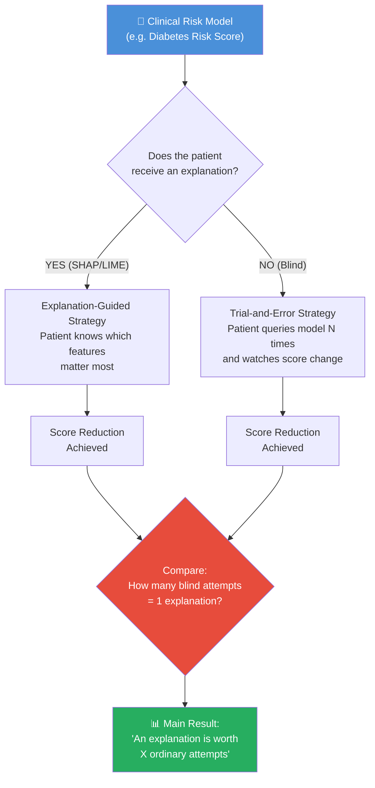
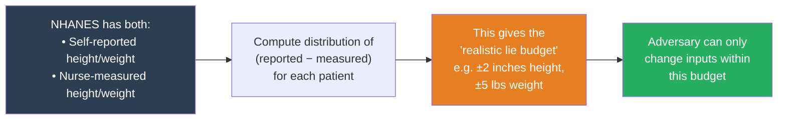
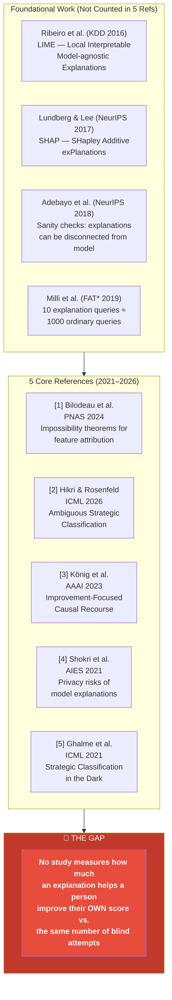
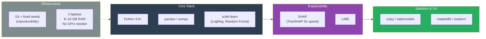
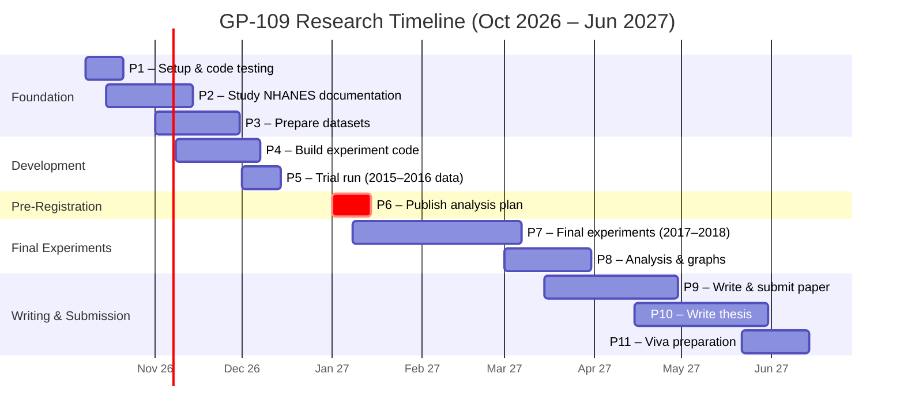
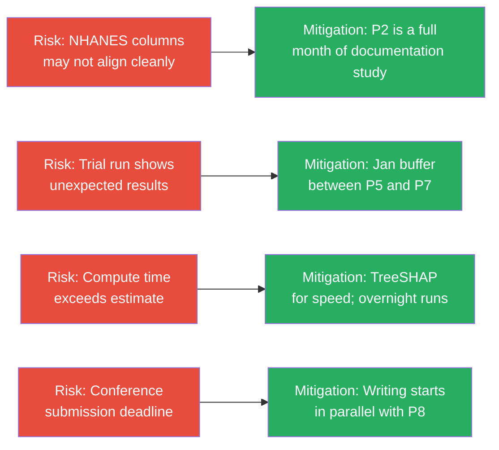

# 🔬 Deep Analysis — GP-109 Research Plan
## *"Can an AI Explanation Be Misused? Testing Whether SHAP and LIME Explanations Help Someone Cheat a Clinical Risk Model"*

> **Document**: [GP109_Detailed_Research_Plan_updated.pdf](file:///c:/Users/ashua/OneDrive/ドキュメント/Desktop/BTP/GP109_Detailed_Research_Plan_updated.pdf)
> **Institution**: Delhi Technological University, Dept. of Computer Science & Engineering
> **Type**: B.Tech Final Year Project — Detailed Research Plan

---

## 1. Executive Summary

This research investigates a deceptively simple but deeply important question in healthcare AI:

> **"Does giving a patient an AI explanation (SHAP/LIME) help them *game* a clinical risk model more effectively than just trial-and-error?"**

The project compares two adversarial strategies:
1. **Explanation-guided manipulation** — a person uses SHAP/LIME feature attributions to know *which* inputs to lie about.
2. **Blind trial-and-error** — a person gets the *same number of queries* to the model but with *no explanation*, and simply guesses which inputs to change.

The key output is a single, interpretable metric: **how many blind attempts is one explanation worth?**

---

## 2. The Core Research Question — Unpacked

### Why This Matters
- **If explanations add LITTLE advantage** → hiding explanations from patients is pointless; better to show them openly and instead validate input data.
- **If explanations add LARGE advantage** → the two-model comparison reveals *which* data columns are responsible, informing targeted safeguards.

> [!IMPORTANT]
> This is a **novel contribution**. Existing literature (Milli 2019, Shokri 2021) measured model-stealing or privacy attacks. **No prior study** measures how much an explanation helps a person improve *their own score* vs. the same number of blind attempts.

---

## 3. Team & Supervision

| Role | Name | ID |
|------|------|----|
| **Member 1** | Akash Singh | 23/CS/036 |
| **Member 2** | Aditya Jha | 23/CS/025 |
| **Member 3** | Akshat Kumar | 23/CS/039 |
| **Junior Member** | Ishan Singh (2nd Year) | 25/CS/168 |
| **Guide** | Miss. Anjali Bansal | Dept. of CSE |

---

## 4. Methodology — End-to-End Flow

This is the complete experimental pipeline, broken into logical stages:

```mermaid
flowchart TB
    subgraph Stage1["📥 STAGE 1: Data Acquisition & Preparation"]
        direction TB
        D1["Download NHANES<br/>2015–2016 & 2017–2018<br/>Survey + Examination Files"]
        D2["Identify columns:<br/>• Self-reported (height, weight)<br/>• Nurse-measured (height, weight)<br/>• Blood-test outcome (diabetes)"]
        D3["Merge survey + exam files<br/>Document every column"]
        D4["Measure reported-vs-measured gap<br/>(how much do people misreport?)"]
        D1 --> D2 --> D3 --> D4
    end

    subgraph Stage2["🤖 STAGE 2: Model Training"]
        direction TB
        M1["Model A: MEASURED Model<br/>Uses nurse-measured height/weight<br/>+ other features → Diabetes risk"]
        M2["Model B: SELF-REPORTED Model<br/>Uses self-reported height/weight<br/>+ other features → Diabetes risk"]
        M3["Both trained with:<br/>• Logistic Regression<br/>• Random Forest<br/>(scikit-learn)"]
        M1 --> M3
        M2 --> M3
    end

    subgraph Stage3["🔍 STAGE 3: Explanation Generation"]
        direction TB
        E1["Generate SHAP explanations<br/>(TreeSHAP for Random Forest)"]
        E2["Generate LIME explanations<br/>(Local surrogate models)"]
        E1 --> E3["Feature attribution vectors<br/>for each patient"]
        E2 --> E3
    end

    subgraph Stage4["⚔️ STAGE 4: Adversarial Simulation"]
        direction TB
        A1["Strategy 1: EXPLANATION-GUIDED<br/>• See SHAP/LIME attributions<br/>• Change the most influential<br/>  self-reported feature<br/>• Constrained by realistic lie<br/>  (from reported-vs-measured gap)"]
        A2["Strategy 2: BLIND TRIAL-AND-ERROR<br/>• No explanation shown<br/>• Same N queries to the model<br/>• Try random/systematic changes<br/>• Same realistic-lie constraint"]
        A1 --> A3["Measure score reduction<br/>for each strategy"]
        A2 --> A3
    end

    subgraph Stage5["📊 STAGE 5: Analysis & Reporting"]
        direction TB
        R1["Compute: explanation-equivalent<br/>'1 explanation ≈ X blind attempts'"]
        R2["Compare Model A vs Model B<br/>(measured vs self-reported inputs)"]
        R3["Statistical testing<br/>(scipy, statsmodels)"]
        R4["Visualizations<br/>(matplotlib, seaborn)"]
        R1 --> R3
        R2 --> R3
        R3 --> R4
    end

    Stage1 --> Stage2 --> Stage3 --> Stage4 --> Stage5

    style Stage1 fill:#1a1a2e,color:#fff
    style Stage2 fill:#16213e,color:#fff
    style Stage3 fill:#0f3460,color:#fff
    style Stage4 fill:#533483,color:#fff
    style Stage5 fill:#e94560,color:#fff
```

---

## 5. The "Two-Model" Design — A Clever Innovation

The project doesn't just test one model — it trains **two identical models** that differ in a single column:

| | Model A ("Measured") | Model B ("Self-Reported") |
|---|---|---|
| **Height/Weight Source** | Nurse-measured values | Patient self-reported values |
| **All Other Features** | Identical | Identical |
| **Target Variable** | Diabetes (blood test) | Diabetes (blood test) |
| **Purpose** | Ground truth baseline | Reflects real-world gaming scenario |

### Why This Matters

The **gap** between Model A and Model B's vulnerability to gaming reveals:
- How much the *type* of input data (verified vs. unverified) matters for security
- Whether the problem is fundamentally about *explanations* or about *unverified inputs*

> [!TIP]
> The NHANES dataset is uniquely suited for this because it records **both** self-reported AND nurse-measured height/weight for the same individuals, plus diabetes outcomes from blood tests. This natural "paired" structure avoids the need for any synthetic data.

---

## 6. The "Realistic Lie" Constraint

A critical design decision: the adversary is not allowed to lie arbitrarily. The magnitude of permissible deception is bounded by the **real distribution of reporting errors** observed in NHANES.

This is ecologically valid — the adversary's lies are calibrated to real human behavior, not arbitrary perturbation bounds.

---

## 7. Literature Positioning — The Research Gap

### Key distinctions from prior work:

| Prior Work | What They Studied | What's Different Here |
|---|---|---|
| Milli et al. (2019) | Model-stealing via explanations | This project studies **self-score manipulation**, not stealing |
| Shokri et al. (2021) | Privacy leakage from explanations | This project studies **gaming**, not data extraction |
| Ghalme et al. (2021) | Hiding decisions from strategic agents | This project **measures the gap**, not just proves existence |
| König et al. (2023) | Causal recourse (real improvement) | This project measures **gaming** (cosmetic, not real improvement) |
| Bilodeau et al. (2024) | Impossibility theorems (theoretical) | This project provides **empirical measurement** |

---

## 8. Data Pipeline Detail

| Dataset | Source | Role | Split |
|---|---|---|---|
| **NHANES 2015–2016** | CDC (public, anonymous) | Trial run / development set | Used in P5 for tuning |
| **NHANES 2017–2018** | CDC (public, anonymous) | **Held-out final experiment** | Only touched in P7 |
| CDC Diabetes Health Indicators | UCI #891 | Comparison / sanity check | Supporting |
| UCI Heart Disease | UCI #45 | Code testing | Supporting |

> [!WARNING]
> The 2017–2018 data is deliberately kept **unseen until P7** (Jan 2027). This is a pre-registration-style safeguard: the team publishes their analysis plan in P6 *before* touching the final data, preventing post-hoc adjustments.

---

## 9. Technical Stack

| Resource | Estimate |
|---|---|
| **Storage** | < 5 GB total |
| **Model training** | Few minutes |
| **SHAP generation** | Few minutes (TreeSHAP) |
| **Main experiments** | 6–11 hours (overnight batch) |
| **Total compute** | 30–50 hours, all on personal laptops |

---

## 10. Timeline — 11 Phases Over 9 Months

### Phase Dependencies & Overlaps

> [!NOTE]
> Phases are deliberately overlapping (e.g., P2+P3, P4+P5) to allow iterative refinement. The **critical milestone** is P6 (pre-registration of analysis plan), which acts as the commitment point.

| Phase | Period | Key Deliverable | Dependencies |
|---|---|---|---|
| **P1** | 8–21 Oct 2026 | Working dev environment, tested on toy data | None |
| **P2** | 15 Oct–14 Nov 2026 | Column selection doc for NHANES | Overlaps with P1 |
| **P3** | 1–30 Nov 2026 | Merged dataset + reported-vs-measured gap analysis | P2 |
| **P4** | 8 Nov–7 Dec 2026 | Experiment code + both trained models | P3 (partial) |
| **P5** | 1–14 Dec 2026 | First results on 2015–2016 data (trial run) | P4 |
| **P6** | 1–14 Jan 2027 | **Published analysis plan (pre-registered)** | P5 |
| **P7** | 8 Jan–7 Mar 2027 | Final experiment results on held-out 2017–2018 data | P6 ✅ |
| **P8** | 1–31 Mar 2027 | Graphs, tables, statistical analysis | P7 |
| **P9** | 15 Mar–30 Apr 2027 | Research paper submitted to conference | P8 |
| **P10** | 15 Apr–31 May 2027 | B.Tech thesis document | P9 (partial) |
| **P11** | 22 May–14 Jun 2027 | Viva presentation + final submission | P10 |

---

## 11. Expected Deliverables

| # | Deliverable | Description |
|---|---|---|
| 1 | **Working Software** | Python pipeline: data prep → model training → explanations → adversarial simulation → measurement |
| 2 | **Prepared Datasets** | Merged NHANES files with self-reported vs. measured columns documented |
| 3 | **Reported-vs-Measured Study** | Distribution of real human misreporting, used to calibrate the "realistic lie" budget |
| 4 | **Published Analysis Plan** | Time-stamped, public pre-registration of methodology and expected results |
| 5 | **Main Result** | "1 SHAP/LIME explanation ≈ X blind attempts" — a single interpretable number with graphs |
| 6 | **Two-Model Comparison** | Measured-input model vs. self-reported model vulnerability analysis |
| 7 | **Project Report** | Final year thesis + viva presentation |

---

## 12. Expected Findings & Interpretation

The team states their **prior expectation** upfront (a hallmark of good scientific practice):

> *"We expect to find that explanations give only a **small** advantage compared with simply trying the model a few times."*

### Interpretation Matrix

| Finding | Implication | Recommended Action |
|---|---|---|
| **Explanations add LITTLE** | Hiding explanations is security theater | Show explanations openly; invest in input verification instead |
| **Explanations add A LOT** | Explanations are a genuine attack vector | Two-model comparison reveals which features/data types drive the vulnerability |

> [!IMPORTANT]
> Both outcomes are publishable. The pre-registration (P6) ensures the conclusion cannot be adjusted to fit the result.

---

## 13. Methodological Safeguards

The plan includes several integrity mechanisms:

1. **Temporal data split**: 2015–2016 for development; 2017–2018 held out for final test
2. **Pre-registration**: Analysis plan published with timestamp before final experiment
3. **Fixed random seeds**: All code reproducible via Git
4. **Ecological validity**: Lie budgets derived from real human reporting behavior
5. **No synthetic data**: All perturbations grounded in observed NHANES distributions
6. **No ethics approval needed**: All datasets are public and anonymous

---

## 14. Critical Path & Risk Assessment

---

## 15. Summary — The Big Picture in One Sentence

> This project empirically measures — for the first time — whether SHAP/LIME explanations on a diabetes risk model give a dishonest patient any meaningful advantage over simply trying different answers, using real human misreporting data from NHANES as the adversary's "lie budget," with a pre-registered analysis plan to guarantee scientific integrity.
