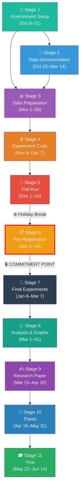
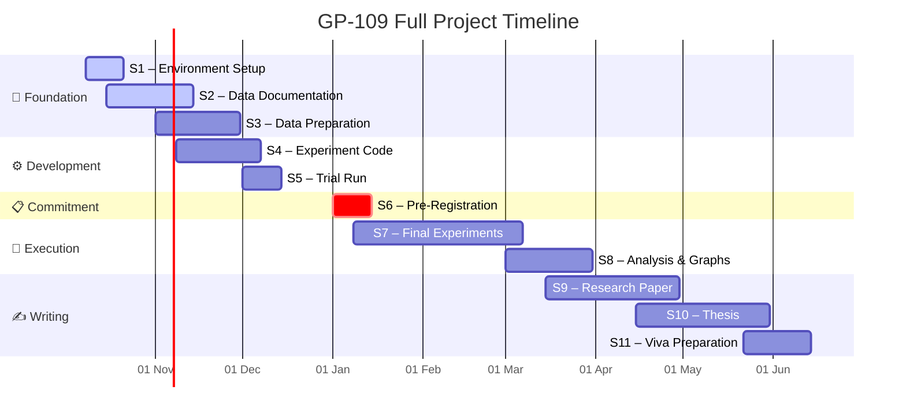

# 🗺️ GP-109 Master Roadmap
## Can an AI Explanation Be Misused? — Full Project Roadmap

> **Project**: B.Tech Final Year Project, DTU — Department of CSE
> **Group**: GP-109 | **Guide**: Miss. Anjali Bansal
> **Duration**: October 2026 – June 2027 (9 months)

---

## Quick Navigation — Stage Documents

| Stage | Document | Period | Status |
|-------|----------|--------|--------|
| Stage 1 | [Environment Setup & Code Testing](file:///c:/Users/ashua/OneDrive/ドキュメント/Desktop/BTP/roadmap/01_environment_setup.md) | 8–21 Oct 2026 | 🟡 In Progress |
| Stage 2 | [NHANES Data Documentation & Column Selection](file:///c:/Users/ashua/OneDrive/ドキュメント/Desktop/BTP/roadmap/02_data_documentation.md) | 15 Oct–14 Nov 2026 | 🟡 In Progress |
| Stage 3 | [Data Preparation & Reported-vs-Measured Analysis](file:///c:/Users/ashua/OneDrive/ドキュメント/Desktop/BTP/roadmap/03_data_preparation.md) | 1–30 Nov 2026 | ⚪ Not Started |
| Stage 4 | [Experiment Code & Model Training](file:///c:/Users/ashua/OneDrive/ドキュメント/Desktop/BTP/roadmap/04_experiment_code.md) | 8 Nov–7 Dec 2026 | ⚪ Not Started |
| Stage 5 | [Trial Run on 2015–2016 Data](file:///c:/Users/ashua/OneDrive/ドキュメント/Desktop/BTP/roadmap/05_trial_run.md) | 1–14 Dec 2026 | ⚪ Not Started |
| Stage 6 | [Pre-Registration & Analysis Plan](file:///c:/Users/ashua/OneDrive/ドキュメント/Desktop/BTP/roadmap/06_preregistration.md) | 1–14 Jan 2027 | ⚪ Not Started |
| Stage 7 | [Final Experiments on 2017–2018 Data](file:///c:/Users/ashua/OneDrive/ドキュメント/Desktop/BTP/roadmap/07_final_experiments.md) | 8 Jan–7 Mar 2027 | ⚪ Not Started |
| Stage 8 | [Analysis, Graphs & Statistical Testing](file:///c:/Users/ashua/OneDrive/ドキュメント/Desktop/BTP/roadmap/08_analysis.md) | 1–31 Mar 2027 | ⚪ Not Started |
| Stage 9 | [Research Paper Writing & Submission](file:///c:/Users/ashua/OneDrive/ドキュメント/Desktop/BTP/roadmap/09_paper_writing.md) | 15 Mar–30 Apr 2027 | ⚪ Not Started |
| Stage 10 | [Thesis & Final Report](file:///c:/Users/ashua/OneDrive/ドキュメント/Desktop/BTP/roadmap/10_thesis.md) | 15 Apr–31 May 2027 | ⚪ Not Started |
| Stage 11 | [Viva Preparation & Final Submission](file:///c:/Users/ashua/OneDrive/ドキュメント/Desktop/BTP/roadmap/11_viva.md) | 22 May–14 Jun 2027 | ⚪ Not Started |

---

## Project Architecture — How the Stages Connect

> [!IMPORTANT]
> **Stage 6 (Pre-Registration)** is the critical commitment point. After publishing the analysis plan, the methodology is locked — no post-hoc adjustments. The 2017–2018 data must NOT be touched before this stage is complete.

---

## Timeline — Gantt View

---

## Team Responsibility Matrix

| Stage | Akash Singh | Aditya Jha | Akshat Kumar | Ishan Singh (Jr.) |
|-------|-------------|------------|--------------|-------------------|
| S1 – Setup | Python env + Git | Libraries + seeds | UCI test datasets | Learn project basics |
| S2 – Documentation | Survey file columns | Exam file columns | Self-report markers | Help organize docs |
| S3 – Data Prep | Merge pipeline | Gap analysis | Validation checks | Data cleaning assist |
| S4 – Experiment Code | Model training code | SHAP/LIME generation | Adversarial simulation | Unit test writing |
| S5 – Trial Run | Run experiments | Collect results | First visualizations | Log management |
| S6 – Pre-Reg | Draft analysis plan | Review & verify | Format for publication | Proofread |
| S7 – Final Experiments | Execute pipeline | Monitor & log | Validate outputs | Progress tracking |
| S8 – Analysis | Statistical tests | Graph generation | Table formatting | Data organization |
| S9 – Paper | Introduction + Related Work | Methodology | Results + Discussion | Bibliography |
| S10 – Thesis | Chapters 1–3 | Chapters 4–5 | Chapters 6–7 | Formatting assist |
| S11 – Viva | Slides 1–10 | Slides 11–20 | Demo preparation | Rehearsal audience |

---

## Critical Milestones

| Date | Milestone | Gate Criteria |
|------|-----------|---------------|
| **21 Oct 2026** | ✅ Environment verified | All team members can run `pytest` on toy dataset |
| **14 Nov 2026** | ✅ Column selection locked | Complete NHANES column mapping document signed off |
| **30 Nov 2026** | ✅ Dataset ready | Merged dataset + reported-vs-measured gap distribution |
| **14 Dec 2026** | ✅ Trial results | First adversarial simulation results on 2015–2016 data |
| **14 Jan 2027** | 🔒 **Analysis plan published** | Time-stamped pre-registration publicly accessible |
| **7 Mar 2027** | ✅ Final experiments done | All runs complete on 2017–2018 held-out data |
| **30 Apr 2027** | ✅ Paper submitted | Conference submission confirmed |
| **31 May 2027** | ✅ Thesis submitted | Final report uploaded to university portal |
| **14 Jun 2027** | 🎓 **Viva complete** | Project defense done |

---

## How to Use This Roadmap

1. **Start with this file** to understand the overall flow
2. **Click into the stage document** for whichever phase you're currently working on
3. Each stage document contains:
   - Detailed objectives and acceptance criteria
   - Step-by-step implementation tasks with code outlines
   - File/folder structure to create
   - Input requirements and output deliverables
   - Checklist to verify completion before moving on
4. **Update the Status column** in the table above as you progress
