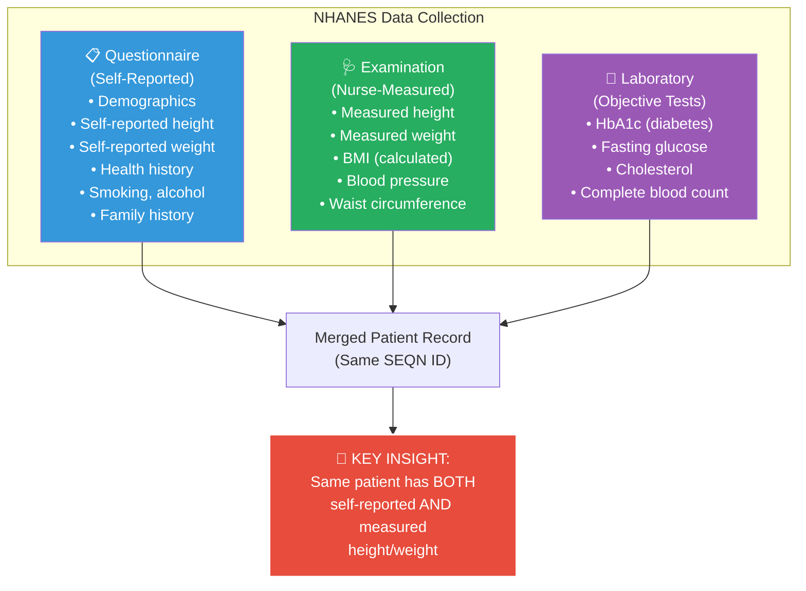
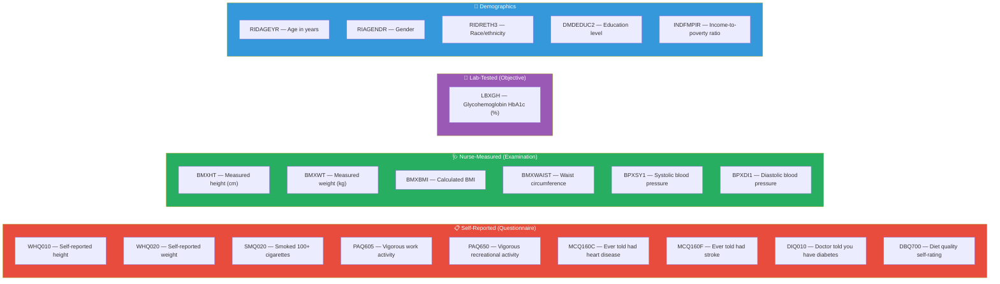

# 📖 Stage 2: NHANES Data Documentation & Column Selection
## Period: 15 October – 14 November 2026 (4 weeks)

> **← Previous**: [Stage 1 — Environment Setup](file:///c:/Users/ashua/OneDrive/ドキュメント/Desktop/BTP/roadmap/01_environment_setup.md)
> **← Back to** [Master Roadmap](file:///c:/Users/ashua/OneDrive/ドキュメント/Desktop/BTP/roadmap/00_master_roadmap.md)
> **→ Next Stage**: [Stage 3 — Data Preparation](file:///c:/Users/ashua/OneDrive/ドキュメント/Desktop/BTP/roadmap/03_data_preparation.md)

---

## 🎯 Objectives

1. Thoroughly study the NHANES documentation for 2015–2016 and 2017–2018 survey rounds
2. Identify and select all relevant feature columns for diabetes risk prediction
3. Critically classify each column as **self-reported** vs. **nurse-measured** vs. **lab-tested**
4. Document the paired height/weight columns (self-reported AND measured) that are central to the "realistic lie" mechanism
5. Produce a definitive column mapping document that locks the feature set for all subsequent stages

---

## 📋 Prerequisites (from Stage 1)

- [x] Working Python environment
- [x] Git repo initialized
- [x] Internet access for NHANES documentation

---

## 🏛️ Understanding NHANES

### What is NHANES?

The **National Health and Nutrition Examination Survey** (NHANES) is conducted by the **US Centers for Disease Control and Prevention (CDC)**. It is unique because it collects:

1. **Questionnaire data** (self-reported) — demographics, health history, self-reported height/weight
2. **Examination data** (nurse-measured) — physical measurements including height, weight, blood pressure
3. **Laboratory data** (objective) — blood tests including HbA1c (diabetes marker)



### Where to Find the Data

| Component | URL | File Format |
|-----------|-----|-------------|
| NHANES 2015–2016 | https://wwwn.cdc.gov/nchs/nhanes/continuousnhanes/default.aspx?BeginYear=2015 | XPT (SAS Transport) |
| NHANES 2017–2018 | https://wwwn.cdc.gov/nchs/nhanes/continuousnhanes/default.aspx?BeginYear=2017 | XPT (SAS Transport) |
| Documentation | Each file has a linked codebook on the CDC website | HTML/PDF |

---

## 🔨 Step-by-Step Implementation

### Task 2.1 — Download and Catalog All Relevant NHANES Files

The data is split across multiple files. You need to identify which files contain the columns you need.

```python
"""
scripts/download_nhanes.py
Download relevant NHANES data files for both survey rounds.
"""
import os
import urllib.request
import pandas as pd

# Base URLs
BASE_2015 = "https://wwwn.cdc.gov/Nchs/Nhanes/2015-2016/"
BASE_2017 = "https://wwwn.cdc.gov/Nchs/Nhanes/2017-2018/"

# Files to download (filename: description)
FILES = {
    # Demographics
    "DEMO_I.XPT": "Demographics (2015-2016)",
    "DEMO_J.XPT": "Demographics (2017-2018)",
    
    # Body Measures (Examination - nurse measured)
    "BMX_I.XPT": "Body Measures Exam (2015-2016)",
    "BMX_J.XPT": "Body Measures Exam (2017-2018)",
    
    # Weight History (Questionnaire - self reported)
    "WHQ_I.XPT": "Weight History Questionnaire (2015-2016)",
    "WHQ_J.XPT": "Weight History Questionnaire (2017-2018)",
    
    # Glycohemoglobin (Lab - HbA1c for diabetes)
    "GHB_I.XPT": "Glycohemoglobin / HbA1c (2015-2016)",
    "GHB_J.XPT": "Glycohemoglobin / HbA1c (2017-2018)",
    
    # Diabetes Questionnaire (self-reported diabetes history)
    "DIQ_I.XPT": "Diabetes Questionnaire (2015-2016)",
    "DIQ_J.XPT": "Diabetes Questionnaire (2017-2018)",
    
    # Blood Pressure (Examination)
    "BPX_I.XPT": "Blood Pressure Exam (2015-2016)",
    "BPX_J.XPT": "Blood Pressure Exam (2017-2018)",
    
    # Smoking (Questionnaire)
    "SMQ_I.XPT": "Smoking Questionnaire (2015-2016)",
    "SMQ_J.XPT": "Smoking Questionnaire (2017-2018)",
    
    # Physical Activity (Questionnaire)
    "PAQ_I.XPT": "Physical Activity Questionnaire (2015-2016)",
    "PAQ_J.XPT": "Physical Activity Questionnaire (2017-2018)",
    
    # Diet / Nutrition
    "DBQ_I.XPT": "Diet Behavior Questionnaire (2015-2016)",
    "DBQ_J.XPT": "Diet Behavior Questionnaire (2017-2018)",
    
    # Medical Conditions
    "MCQ_I.XPT": "Medical Conditions Questionnaire (2015-2016)",
    "MCQ_J.XPT": "Medical Conditions Questionnaire (2017-2018)",
}

def download_nhanes_files(output_dir="data/raw"):
    """Download all listed NHANES XPT files."""
    for filename, description in FILES.items():
        # Determine cycle
        if "_I." in filename:
            base = BASE_2015
            subdir = os.path.join(output_dir, "nhanes_2015_2016")
        else:
            base = BASE_2017
            subdir = os.path.join(output_dir, "nhanes_2017_2018")
        
        os.makedirs(subdir, exist_ok=True)
        filepath = os.path.join(subdir, filename)
        
        if os.path.exists(filepath):
            print(f"  [SKIP] {filename} already exists")
            continue
        
        url = base + filename
        print(f"  [DOWNLOAD] {description}: {url}")
        try:
            urllib.request.urlretrieve(url, filepath)
            print(f"    → Saved to {filepath}")
        except Exception as e:
            print(f"    → ERROR: {e}")

if __name__ == "__main__":
    download_nhanes_files()
```

### Task 2.2 — Build the Column Mapping Document

This is the **key deliverable** of Stage 2. Read each file's codebook and classify every column.

```python
"""
scripts/explore_nhanes_columns.py
Explore and document all columns in downloaded NHANES files.
"""
import pandas as pd
import os

def explore_file(filepath):
    """Load an XPT file and print column info."""
    df = pd.read_sas(filepath, format='xport')
    print(f"\n{'='*60}")
    print(f"File: {os.path.basename(filepath)}")
    print(f"Shape: {df.shape}")
    print(f"\nColumns:")
    for col in df.columns:
        print(f"  {col:20s}  non-null: {df[col].notna().sum():6d}  "
              f"dtype: {df[col].dtype}  "
              f"unique: {df[col].nunique():6d}  "
              f"sample: {df[col].dropna().iloc[0] if df[col].notna().any() else 'ALL NULL'}")
    return df

# Explore all files for 2015-2016
raw_dir = "data/raw/nhanes_2015_2016"
if os.path.exists(raw_dir):
    for f in sorted(os.listdir(raw_dir)):
        if f.endswith('.XPT'):
            explore_file(os.path.join(raw_dir, f))
```

### Task 2.3 — Classify All Selected Columns

This is the core intellectual work. Create this mapping in `docs/column_mapping.md`:

#### The Critical Self-Reported vs. Measured Pairs

| Feature | Self-Reported Source | Measured Source | Notes |
|---------|---------------------|-----------------|-------|
| **Height** | `WHQ010` (WHQ file) — "How tall are you without shoes?" | `BMXHT` (BMX file) — Standing height (cm), nurse-measured | **Core pair for lie budget** |
| **Weight** | `WHQ020` (WHQ file) — "How much do you weigh without clothes/shoes?" | `BMXWT` (BMX file) — Weight (kg), nurse-measured | **Core pair for lie budget** |

#### All Candidate Features by Category



### Task 2.4 — Define the Diabetes Target Variable

The target variable comes from lab data (objective, not self-reported):

```python
"""
Definition of diabetes outcome variable.
Based on HbA1c thresholds from the American Diabetes Association.
"""

def define_diabetes_target(df):
    """
    Create binary diabetes target from HbA1c lab results.
    
    ADA Thresholds:
    - Normal:       HbA1c < 5.7%
    - Pre-diabetes: 5.7% <= HbA1c < 6.5%
    - Diabetes:     HbA1c >= 6.5%
    
    For this study, we use a binary target:
    - 0 = No diabetes (HbA1c < 6.5%)
    - 1 = Diabetes (HbA1c >= 6.5%)
    
    This is an OBJECTIVE measurement — not self-reported.
    A patient cannot manipulate their blood test result.
    """
    df['diabetes_target'] = (df['LBXGH'] >= 6.5).astype(int)
    return df
```

> [!IMPORTANT]
> The target variable (diabetes) comes from a blood test, which the patient CANNOT fake. This is essential to the study design — the adversary can only manipulate their *inputs* (height, weight), not the *outcome*.

### Task 2.5 — Document Which Features Can Be Gamed

Create a classification of gameability:

| Feature | Can Patient Lie? | Reason | Constraint Type |
|---------|-----------------|--------|-----------------|
| Self-reported height | ✅ YES | Patient verbally reports | Bounded by reported-vs-measured gap |
| Self-reported weight | ✅ YES | Patient verbally reports | Bounded by reported-vs-measured gap |
| Smoking status | ✅ YES | Self-reported binary | Can flip yes/no |
| Physical activity | ✅ YES | Self-reported | Can claim more activity |
| Diet quality | ✅ YES | Self-reported | Can claim better diet |
| Measured height | ❌ NO | Nurse measures directly | Not manipulable |
| Measured weight | ❌ NO | Nurse measures directly | Not manipulable |
| Blood pressure | ❌ NO | Nurse measures directly | Not manipulable |
| HbA1c (target) | ❌ NO | Lab blood test | Not manipulable |
| Age | ❌ NO | Verified by ID | Not manipulable |
| Gender | ❌ NO | Recorded by staff | Not manipulable |

---

## 📤 Deliverables

| # | Deliverable | Format | Location |
|---|-------------|--------|----------|
| 1 | **Column Mapping Document** | Markdown | `docs/column_mapping.md` |
| 2 | **Downloaded NHANES Files** | XPT files | `data/raw/nhanes_*/` |
| 3 | **Column Explorer Script** | Python | `scripts/explore_nhanes_columns.py` |
| 4 | **Feature Gameability Classification** | Table in column mapping doc | `docs/column_mapping.md` |
| 5 | **Diabetes Target Definition** | Python function | `src/data_loader.py` |

---

## ✅ Completion Checklist

- [ ] All relevant NHANES XPT files downloaded for **both** 2015–2016 AND 2017–2018
- [ ] Every column in every file explored and documented
- [ ] Self-reported vs. nurse-measured vs. lab-tested classification complete
- [ ] Height pair identified: `WHQ010` (self-reported) ↔ `BMXHT` (measured)
- [ ] Weight pair identified: `WHQ020` (self-reported) ↔ `BMXWT` (measured)
- [ ] Diabetes target defined from `LBXGH` (HbA1c ≥ 6.5%)
- [ ] Feature gameability table created
- [ ] Column mapping document reviewed by all team members
- [ ] Document committed to Git
- [ ] **2017–2018 files downloaded but NOT opened or explored** (held out for Stage 7)

> [!CAUTION]
> **DO NOT** perform any analysis on the 2017–2018 data during this stage. You may download it and verify the file structure matches 2015–2016, but do not compute statistics, train models, or even view distributions. This data is held out for the final experiment (Stage 7) to preserve pre-registration integrity.
