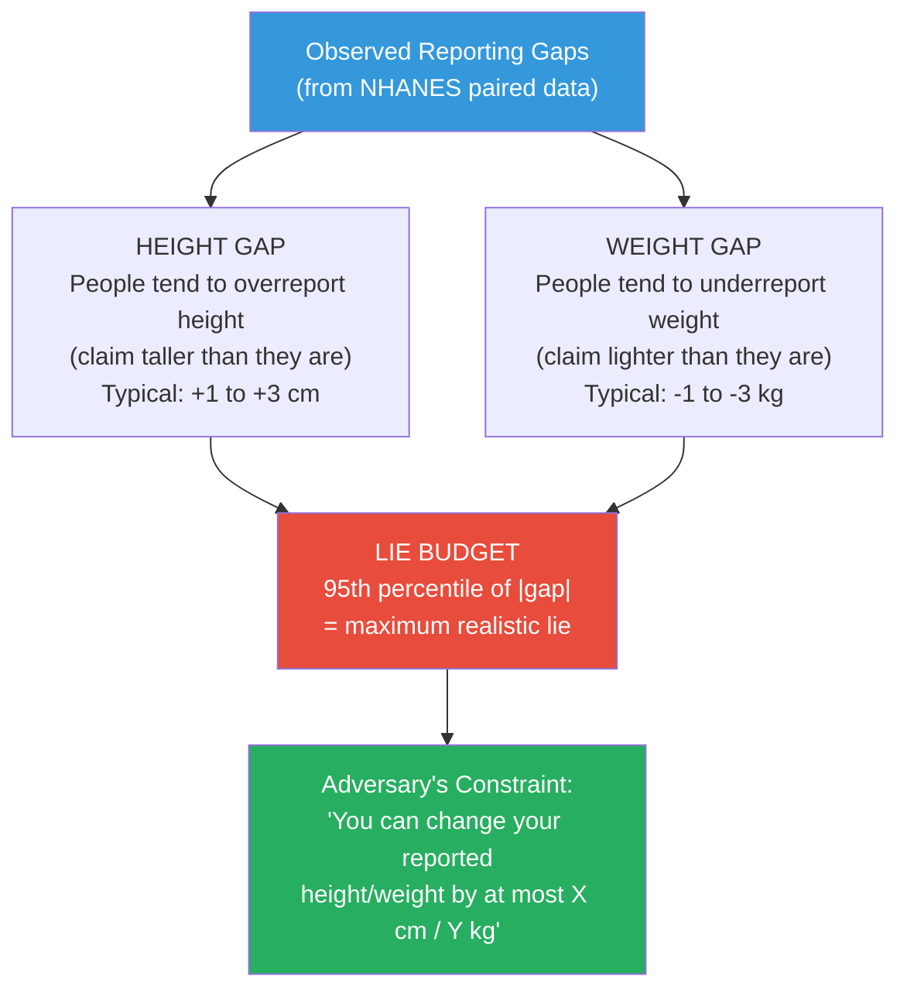

# 📊 Stage 3: Data Preparation & Reported-vs-Measured Analysis
## Period: 1 November – 30 November 2026 (4 weeks)

> **← Previous**: [Stage 2 — Data Documentation](file:///c:/Users/ashua/OneDrive/ドキュメント/Desktop/BTP/roadmap/02_data_documentation.md)
> **← Back to** [Master Roadmap](file:///c:/Users/ashua/OneDrive/ドキュメント/Desktop/BTP/roadmap/00_master_roadmap.md)
> **→ Next Stage**: [Stage 4 — Experiment Code](file:///c:/Users/ashua/OneDrive/ドキュメント/Desktop/BTP/roadmap/04_experiment_code.md)

---

## 🎯 Objectives

1. Merge all NHANES component files (demographics, body measures, questionnaire, lab) into a single analysis-ready dataset
2. Handle missing values, outliers, and data type conversions
3. **Measure the reported-vs-measured gap** — the distribution of (self-reported − nurse-measured) for height and weight
4. Produce the **"realistic lie budget"** that constrains the adversary in the experiment
5. Generate summary statistics and distribution plots for the development dataset (2015–2016 only)

---

## 📋 Prerequisites (from Stage 2)

- [x] Column mapping document complete
- [x] All NHANES XPT files downloaded
- [x] Feature classification (self-reported / measured / lab) finalized
- [x] Diabetes target variable definition agreed

---

## 🔨 Step-by-Step Implementation

### Task 3.1 — Merge NHANES Component Files

All NHANES files share a common patient identifier: `SEQN`. Merge on this key.

```python
"""
src/data_loader.py
Load and merge NHANES component files into a single dataset.
"""
import pandas as pd
import numpy as np
import os
from src.config import DATA_RAW, DATA_PROCESSED

def load_xpt(filepath):
    """Load a SAS XPT file into a pandas DataFrame."""
    return pd.read_sas(filepath, format='xport')

def merge_nhanes(cycle='2015_2016'):
    """
    Merge all NHANES component files for a given survey cycle.
    
    Parameters
    ----------
    cycle : str
        '2015_2016' or '2017_2018'
    
    Returns
    -------
    pd.DataFrame
        Merged dataset with all selected columns
    """
    suffix = 'I' if cycle == '2015_2016' else 'J'
    raw_dir = os.path.join(DATA_RAW, f'nhanes_{cycle}')
    
    # Load each component
    demo = load_xpt(os.path.join(raw_dir, f'DEMO_{suffix}.XPT'))
    bmx  = load_xpt(os.path.join(raw_dir, f'BMX_{suffix}.XPT'))
    whq  = load_xpt(os.path.join(raw_dir, f'WHQ_{suffix}.XPT'))
    ghb  = load_xpt(os.path.join(raw_dir, f'GHB_{suffix}.XPT'))
    diq  = load_xpt(os.path.join(raw_dir, f'DIQ_{suffix}.XPT'))
    bpx  = load_xpt(os.path.join(raw_dir, f'BPX_{suffix}.XPT'))
    smq  = load_xpt(os.path.join(raw_dir, f'SMQ_{suffix}.XPT'))
    paq  = load_xpt(os.path.join(raw_dir, f'PAQ_{suffix}.XPT'))
    
    print(f"Component shapes for {cycle}:")
    print(f"  DEMO: {demo.shape}")
    print(f"  BMX:  {bmx.shape}")
    print(f"  WHQ:  {whq.shape}")
    print(f"  GHB:  {ghb.shape}")
    print(f"  DIQ:  {diq.shape}")
    print(f"  BPX:  {bpx.shape}")
    print(f"  SMQ:  {smq.shape}")
    print(f"  PAQ:  {paq.shape}")
    
    # ---- Select columns from each file ----
    demo_cols = ['SEQN', 'RIDAGEYR', 'RIAGENDR', 'RIDRETH3', 'DMDEDUC2', 'INDFMPIR']
    bmx_cols  = ['SEQN', 'BMXHT', 'BMXWT', 'BMXBMI', 'BMXWAIST']
    whq_cols  = ['SEQN', 'WHD010', 'WHD020']  # Self-reported height/weight
    ghb_cols  = ['SEQN', 'LBXGH']              # HbA1c
    bpx_cols  = ['SEQN', 'BPXSY1', 'BPXDI1']  # Systolic/Diastolic BP
    smq_cols  = ['SEQN', 'SMQ020']             # Smoking
    paq_cols  = ['SEQN', 'PAQ605', 'PAQ650']   # Physical activity
    
    # ---- Merge all on SEQN ----
    merged = demo[demo_cols].copy()
    
    for df, cols, name in [
        (bmx, bmx_cols, 'BMX'),
        (whq, whq_cols, 'WHQ'),
        (ghb, ghb_cols, 'GHB'),
        (bpx, bpx_cols, 'BPX'),
        (smq, smq_cols, 'SMQ'),
        (paq, paq_cols, 'PAQ'),
    ]:
        available_cols = [c for c in cols if c in df.columns]
        merged = merged.merge(df[available_cols], on='SEQN', how='left')
        print(f"  After merging {name}: {merged.shape}")
    
    print(f"\nFinal merged shape: {merged.shape}")
    return merged


def create_diabetes_target(df):
    """
    Create binary diabetes target from HbA1c.
    
    0 = No diabetes (HbA1c < 6.5%)
    1 = Diabetes (HbA1c >= 6.5%)
    """
    df = df.copy()
    df['diabetes'] = (df['LBXGH'] >= 6.5).astype(float)
    # Drop rows where HbA1c is missing (can't determine diabetes status)
    df = df.dropna(subset=['diabetes'])
    return df
```

### Task 3.2 — Handle Missing Values and Clean Data

```python
"""
src/data_loader.py (continued)
Data cleaning and preprocessing functions.
"""

def clean_nhanes(df):
    """
    Clean the merged NHANES dataset.
    
    Steps:
    1. Filter adults only (age >= 18)
    2. Handle NHANES special codes (7=Refused, 9=Don't Know)
    3. Convert units for self-reported height/weight
    4. Remove rows with too many missing values
    """
    df = df.copy()
    
    # ---- Step 1: Adults only ----
    df = df[df['RIDAGEYR'] >= 18].copy()
    print(f"After filtering adults: {len(df)} rows")
    
    # ---- Step 2: Replace NHANES special codes with NaN ----
    # 7 = Refused, 9 = Don't Know (for most questionnaire items)
    # 77777/99999 = Refused/Don't Know (for numeric items)
    refuse_codes = [7, 9, 77, 99, 777, 999, 7777, 9999, 77777, 99999]
    for col in ['WHD010', 'WHD020', 'SMQ020', 'PAQ605', 'PAQ650', 'DMDEDUC2']:
        if col in df.columns:
            df[col] = df[col].replace(refuse_codes, np.nan)
    
    # ---- Step 3: Unit conversion for self-reported height/weight ----
    # WHD010 = self-reported height in INCHES
    # WHD020 = self-reported weight in POUNDS
    # BMXHT  = measured height in CM
    # BMXWT  = measured weight in KG
    
    # Convert self-reported to metric for comparability
    df['self_height_cm'] = df['WHD010'] * 2.54          # inches → cm
    df['self_weight_kg'] = df['WHD020'] * 0.453592       # pounds → kg
    
    # Rename measured columns for clarity
    df['measured_height_cm'] = df['BMXHT']
    df['measured_weight_kg'] = df['BMXWT']
    
    # ---- Step 4: Remove rows missing critical columns ----
    critical_cols = ['LBXGH', 'RIDAGEYR', 'RIAGENDR']
    df = df.dropna(subset=critical_cols)
    print(f"After dropping missing critical cols: {len(df)} rows")
    
    return df
```

### Task 3.3 — Compute the Reported-vs-Measured Gap (THE KEY ANALYSIS)

This is the most important analysis in Stage 3. It produces the **"realistic lie budget"**.

```python
"""
src/gap_analysis.py
Measure how much people's self-reported height/weight differs 
from the nurse's measurement. This defines the 'realistic lie budget'.
"""
import pandas as pd
import numpy as np
import matplotlib.pyplot as plt
import seaborn as sns
from scipy import stats

def compute_reporting_gap(df):
    """
    Compute the gap between self-reported and nurse-measured values.
    
    Returns a DataFrame with gap columns and summary statistics.
    """
    df = df.copy()
    
    # Require both self-reported AND measured values
    height_mask = df['self_height_cm'].notna() & df['measured_height_cm'].notna()
    weight_mask = df['self_weight_kg'].notna() & df['measured_weight_kg'].notna()
    
    # ---- Height gap ----
    df.loc[height_mask, 'height_gap_cm'] = (
        df.loc[height_mask, 'self_height_cm'] - 
        df.loc[height_mask, 'measured_height_cm']
    )
    
    # ---- Weight gap ----
    df.loc[weight_mask, 'weight_gap_kg'] = (
        df.loc[weight_mask, 'self_weight_kg'] - 
        df.loc[weight_mask, 'measured_weight_kg']
    )
    
    # ---- Summary statistics ----
    for gap_col, unit in [('height_gap_cm', 'cm'), ('weight_gap_kg', 'kg')]:
        gap = df[gap_col].dropna()
        print(f"\n{'='*50}")
        print(f"REPORTING GAP: {gap_col}")
        print(f"{'='*50}")
        print(f"  N samples:  {len(gap)}")
        print(f"  Mean gap:   {gap.mean():+.2f} {unit}")
        print(f"  Median gap: {gap.median():+.2f} {unit}")
        print(f"  Std dev:    {gap.std():.2f} {unit}")
        print(f"  Min:        {gap.min():+.2f} {unit}")
        print(f"  Max:        {gap.max():+.2f} {unit}")
        print(f"  5th pctile: {gap.quantile(0.05):+.2f} {unit}")
        print(f"  95th pctile:{gap.quantile(0.95):+.2f} {unit}")
        print(f"  IQR:        [{gap.quantile(0.25):+.2f}, {gap.quantile(0.75):+.2f}]")
    
    return df


def define_lie_budget(df, method='percentile', pct=95):
    """
    Define the maximum lie magnitude based on observed gaps.
    
    Parameters
    ----------
    df : DataFrame with gap columns
    method : str
        'percentile' — use the Nth percentile of absolute gaps
        'std' — use N standard deviations
    pct : float
        Percentile or number of stds
    
    Returns
    -------
    dict with lie budget for each feature
    """
    budget = {}
    
    for gap_col, feature_name in [
        ('height_gap_cm', 'height'),
        ('weight_gap_kg', 'weight')
    ]:
        gap = df[gap_col].dropna()
        abs_gap = gap.abs()
        
        if method == 'percentile':
            max_lie = abs_gap.quantile(pct / 100)
        elif method == 'std':
            max_lie = abs_gap.mean() + pct * abs_gap.std()
        
        budget[feature_name] = {
            'max_lie': max_lie,
            'mean_direction': 'positive' if gap.mean() > 0 else 'negative',
            'mean_magnitude': abs_gap.mean(),
        }
        
        print(f"\nLIE BUDGET for {feature_name}:")
        print(f"  Max permissible lie: ±{max_lie:.2f}")
        print(f"  People tend to {'overestimate' if gap.mean() > 0 else 'underestimate'}")
        print(f"  Average misreport magnitude: {abs_gap.mean():.2f}")
    
    return budget


def plot_reporting_gaps(df, save_dir='results/figures'):
    """
    Generate publication-quality plots of the reporting gaps.
    """
    os.makedirs(save_dir, exist_ok=True)
    fig, axes = plt.subplots(1, 2, figsize=(14, 5))
    
    # ---- Height gap distribution ----
    ax = axes[0]
    gap_h = df['height_gap_cm'].dropna()
    sns.histplot(gap_h, bins=50, kde=True, ax=ax, color='#3498db', alpha=0.7)
    ax.axvline(x=0, color='red', linestyle='--', linewidth=2, label='Perfect accuracy')
    ax.axvline(x=gap_h.mean(), color='orange', linestyle='-', linewidth=2, 
               label=f'Mean = {gap_h.mean():+.1f} cm')
    ax.set_xlabel('Self-Reported − Measured Height (cm)')
    ax.set_ylabel('Count')
    ax.set_title('Height Reporting Gap Distribution')
    ax.legend()
    
    # ---- Weight gap distribution ----
    ax = axes[1]
    gap_w = df['weight_gap_kg'].dropna()
    sns.histplot(gap_w, bins=50, kde=True, ax=ax, color='#e74c3c', alpha=0.7)
    ax.axvline(x=0, color='red', linestyle='--', linewidth=2, label='Perfect accuracy')
    ax.axvline(x=gap_w.mean(), color='orange', linestyle='-', linewidth=2,
               label=f'Mean = {gap_w.mean():+.1f} kg')
    ax.set_xlabel('Self-Reported − Measured Weight (kg)')
    ax.set_ylabel('Count')
    ax.set_title('Weight Reporting Gap Distribution')
    ax.legend()
    
    plt.tight_layout()
    plt.savefig(os.path.join(save_dir, 'reporting_gaps.png'), dpi=300, bbox_inches='tight')
    plt.show()
    print(f"Saved to {save_dir}/reporting_gaps.png")
```

### What the Gap Tells Us



> [!IMPORTANT]
> The lie budget is the **central innovation** of this research. Instead of allowing arbitrary perturbations (unrealistic), the adversary is constrained to lie only as much as real people actually misreport. This makes the threat model ecologically valid.

### Task 3.4 — Prepare the Two Feature Sets

```python
"""
src/data_loader.py (continued)
Prepare the two feature sets for the two-model comparison.
"""

def prepare_feature_sets(df, selected_features):
    """
    Create two feature matrices from the same patients:
    
    - Model A features: Use MEASURED height/weight (nurse data)
    - Model B features: Use SELF-REPORTED height/weight (patient data)
    - All other features are identical between the two
    
    Parameters
    ----------
    df : pd.DataFrame — cleaned, merged NHANES data
    selected_features : dict — mapping of feature roles
    
    Returns
    -------
    X_measured, X_reported, y : three arrays
    """
    # Common features (same in both models)
    common_features = [
        'RIDAGEYR',      # Age
        'RIAGENDR',      # Gender
        'BPXSY1',        # Systolic BP (measured)
        'SMQ020',        # Smoking (self-reported, but binary)
        'PAQ650',        # Physical activity
    ]
    
    # Model A: Nurse-measured height/weight
    measured_specific = ['measured_height_cm', 'measured_weight_kg']
    
    # Model B: Self-reported height/weight
    reported_specific = ['self_height_cm', 'self_weight_kg']
    
    # Require all features to be non-null
    all_cols = common_features + measured_specific + reported_specific + ['diabetes']
    df_complete = df.dropna(subset=all_cols).copy()
    
    print(f"Rows with complete data for both models: {len(df_complete)}")
    
    X_measured = df_complete[common_features + measured_specific].values
    X_reported = df_complete[common_features + reported_specific].values
    y = df_complete['diabetes'].values
    
    feature_names_measured = common_features + measured_specific
    feature_names_reported = common_features + reported_specific
    
    return X_measured, X_reported, y, feature_names_measured, feature_names_reported, df_complete
```

### Task 3.5 — Save Processed Data

```python
"""
scripts/prepare_data.py
Master script to run all data preparation steps.
"""
import os
import sys
sys.path.append('..')

from src.config import set_all_seeds, DATA_PROCESSED
from src.data_loader import merge_nhanes, clean_nhanes, create_diabetes_target, prepare_feature_sets
from src.gap_analysis import compute_reporting_gap, define_lie_budget, plot_reporting_gaps

set_all_seeds()

# ---- Step 1: Merge and clean (2015-2016 only) ----
print("="*60)
print("PROCESSING NHANES 2015-2016 (Development Set)")
print("="*60)

df = merge_nhanes(cycle='2015_2016')
df = clean_nhanes(df)
df = create_diabetes_target(df)

# ---- Step 2: Compute reporting gaps ----
df = compute_reporting_gap(df)
lie_budget = define_lie_budget(df, method='percentile', pct=95)

# ---- Step 3: Plot gaps ----
plot_reporting_gaps(df)

# ---- Step 4: Prepare feature sets ----
X_meas, X_rep, y, fn_meas, fn_rep, df_complete = prepare_feature_sets(df, {})

print(f"\nFinal dataset summary:")
print(f"  Total patients: {len(df_complete)}")
print(f"  Diabetes positive: {y.sum():.0f} ({y.mean()*100:.1f}%)")
print(f"  Diabetes negative: {len(y) - y.sum():.0f} ({(1-y.mean())*100:.1f}%)")
print(f"  Feature count (each model): {X_meas.shape[1]}")

# ---- Step 5: Save ----
os.makedirs(DATA_PROCESSED, exist_ok=True)

import pickle
output = {
    'X_measured': X_meas,
    'X_reported': X_rep,
    'y': y,
    'feature_names_measured': fn_meas,
    'feature_names_reported': fn_rep,
    'lie_budget': lie_budget,
    'df_complete': df_complete,
}

with open(os.path.join(DATA_PROCESSED, 'nhanes_2015_2016_prepared.pkl'), 'wb') as f:
    pickle.dump(output, f)

print(f"\n✅ Saved processed data to {DATA_PROCESSED}/nhanes_2015_2016_prepared.pkl")
```

---

## 📤 Deliverables

| # | Deliverable | Format | Description |
|---|-------------|--------|-------------|
| 1 | **Merged dataset** | `.pkl` | Single file with all features, both measured and self-reported |
| 2 | **Gap analysis report** | Console + figures | Distribution of (reported − measured) for height and weight |
| 3 | **Lie budget** | Python dict | 95th percentile of absolute gaps — the adversary's constraint |
| 4 | **Gap distribution plots** | `.png` | Publication-quality histograms of reporting gaps |
| 5 | **Two feature sets** | NumPy arrays | X_measured and X_reported, ready for model training |

---

## ✅ Completion Checklist

- [ ] NHANES 2015–2016 files successfully merged on `SEQN`
- [ ] Adults-only filter applied (age ≥ 18)
- [ ] NHANES special codes (7, 9, 77777, 99999) replaced with NaN
- [ ] Self-reported height converted from inches to cm
- [ ] Self-reported weight converted from pounds to kg
- [ ] Diabetes target created from HbA1c ≥ 6.5%
- [ ] Height reporting gap computed and plotted
- [ ] Weight reporting gap computed and plotted
- [ ] Lie budget defined (95th percentile method)
- [ ] Two feature sets (measured vs. self-reported) prepared
- [ ] Processed data saved to `data/processed/`
- [ ] Summary statistics documented
- [ ] All code committed to Git
- [ ] **2017–2018 data still untouched** (confirm)

> [!WARNING]
> **Known patterns in reporting gaps**: Studies consistently show that people tend to **overreport height** (claim to be taller) and **underreport weight** (claim to be lighter). If your NHANES analysis shows the opposite, double-check your unit conversions (inches↔cm, pounds↔kg).
