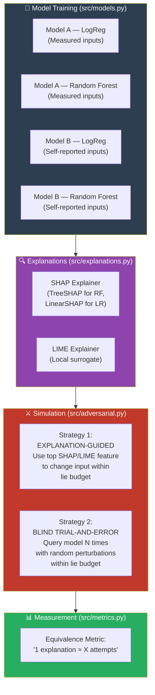

# ⚙️ Stage 4: Experiment Code & Model Training
## Period: 8 November – 7 December 2026 (4 weeks)

> **← Previous**: [Stage 3 — Data Preparation](file:///c:/Users/ashua/OneDrive/ドキュメント/Desktop/BTP/roadmap/03_data_preparation.md)
> **← Back to** [Master Roadmap](file:///c:/Users/ashua/OneDrive/ドキュメント/Desktop/BTP/roadmap/00_master_roadmap.md)
> **→ Next Stage**: [Stage 5 — Trial Run](file:///c:/Users/ashua/OneDrive/ドキュメント/Desktop/BTP/roadmap/05_trial_run.md)

---

## 🎯 Objectives

1. Train the two models (Model A — measured inputs, Model B — self-reported inputs) using both Logistic Regression and Random Forest
2. Build the SHAP and LIME explanation generator module
3. Implement the **adversarial simulation engine** — the core experiment component
4. Implement both adversarial strategies: explanation-guided and blind trial-and-error
5. Build the **equivalence metric**: "1 explanation ≈ X blind attempts"

---

## 📋 Prerequisites (from Stage 3)

- [x] Processed dataset saved (`nhanes_2015_2016_prepared.pkl`)
- [x] Two feature sets ready (X_measured, X_reported)
- [x] Lie budget computed
- [x] Diabetes target variable prepared

---

## 🏗️ Architecture Overview



---

## 🔨 Step-by-Step Implementation

### Task 4.1 — Model Training Module

```python
"""
src/models.py
Train the two models (measured vs self-reported) with two algorithms each.
"""
import numpy as np
from sklearn.model_selection import train_test_split
from sklearn.ensemble import RandomForestClassifier
from sklearn.linear_model import LogisticRegression
from sklearn.preprocessing import StandardScaler
from sklearn.metrics import (
    accuracy_score, precision_score, recall_score, 
    f1_score, roc_auc_score, classification_report
)
from src.config import (
    SEED_MODEL_LOGREG, SEED_MODEL_RF, 
    SEED_TRAIN_TEST_SPLIT, TEST_SIZE,
    N_ESTIMATORS_RF, MAX_DEPTH_RF
)

class DiabetesModel:
    """
    Wrapper for a diabetes risk model.
    Handles training, prediction, and metadata.
    """
    
    def __init__(self, model_type='rf', input_type='measured'):
        """
        Parameters
        ----------
        model_type : str — 'rf' (Random Forest) or 'lr' (Logistic Regression)
        input_type : str — 'measured' or 'reported' 
        """
        self.model_type = model_type
        self.input_type = input_type
        self.model = None
        self.scaler = None
        self.feature_names = None
        self.metrics = {}
        
        if model_type == 'rf':
            self.model = RandomForestClassifier(
                n_estimators=N_ESTIMATORS_RF,
                max_depth=MAX_DEPTH_RF,
                random_state=SEED_MODEL_RF,
                n_jobs=-1
            )
        elif model_type == 'lr':
            self.scaler = StandardScaler()
            self.model = LogisticRegression(
                random_state=SEED_MODEL_LOGREG,
                max_iter=1000
            )
    
    def train(self, X_train, y_train, feature_names=None):
        """Train the model."""
        self.feature_names = feature_names
        if self.scaler:
            X_train = self.scaler.fit_transform(X_train)
        self.model.fit(X_train, y_train)
        
    def predict_proba(self, X):
        """Get probability of diabetes (class 1)."""
        if self.scaler:
            X = self.scaler.transform(X)
        return self.model.predict_proba(X)[:, 1]
    
    def predict(self, X):
        """Get binary prediction."""
        if self.scaler:
            X = self.scaler.transform(X)
        return self.model.predict(X)
    
    def evaluate(self, X_test, y_test):
        """Compute and store evaluation metrics."""
        if self.scaler:
            X_scaled = self.scaler.transform(X_test)
        else:
            X_scaled = X_test
            
        y_pred = self.model.predict(X_scaled)
        y_prob = self.model.predict_proba(X_scaled)[:, 1]
        
        self.metrics = {
            'accuracy': accuracy_score(y_test, y_pred),
            'precision': precision_score(y_test, y_pred, zero_division=0),
            'recall': recall_score(y_test, y_pred, zero_division=0),
            'f1': f1_score(y_test, y_pred, zero_division=0),
            'auc_roc': roc_auc_score(y_test, y_prob),
        }
        
        print(f"\n{'='*50}")
        print(f"Model: {self.model_type.upper()} | Input: {self.input_type}")
        print(f"{'='*50}")
        for metric, value in self.metrics.items():
            print(f"  {metric:12s}: {value:.4f}")
        
        return self.metrics


def train_all_models(X_measured, X_reported, y, fn_measured, fn_reported):
    """
    Train all four models and return them in a dict.
    
    Returns
    -------
    dict with keys: 'measured_rf', 'measured_lr', 'reported_rf', 'reported_lr'
    Also returns X_train, X_test, y_train, y_test splits.
    """
    # Same train/test split for both
    indices = np.arange(len(y))
    idx_train, idx_test = train_test_split(
        indices, test_size=TEST_SIZE, 
        random_state=SEED_TRAIN_TEST_SPLIT, 
        stratify=y
    )
    
    models = {}
    
    for input_type, X, fn in [
        ('measured', X_measured, fn_measured),
        ('reported', X_reported, fn_reported)
    ]:
        X_train, X_test = X[idx_train], X[idx_test]
        y_train, y_test = y[idx_train], y[idx_test]
        
        for model_type in ['rf', 'lr']:
            key = f"{input_type}_{model_type}"
            print(f"\nTraining {key}...")
            m = DiabetesModel(model_type=model_type, input_type=input_type)
            m.train(X_train, y_train, feature_names=fn)
            m.evaluate(X_test, y_test)
            models[key] = m
    
    split = {
        'idx_train': idx_train, 'idx_test': idx_test,
        'y_train': y[idx_train], 'y_test': y[idx_test],
    }
    
    return models, split
```

### Task 4.2 — Explanation Generator Module

```python
"""
src/explanations.py
Generate SHAP and LIME explanations for model predictions.
"""
import numpy as np
import shap
import lime
import lime.lime_tabular
from tqdm import tqdm

class ExplanationGenerator:
    """
    Generate feature attributions using SHAP and LIME.
    """
    
    def __init__(self, model, X_train, feature_names):
        """
        Parameters
        ----------
        model : DiabetesModel instance
        X_train : training data (for LIME background)
        feature_names : list of feature names
        """
        self.model = model
        self.X_train = X_train
        self.feature_names = feature_names
        
        # ---- Initialize SHAP ----
        if model.model_type == 'rf':
            self.shap_explainer = shap.TreeExplainer(model.model)
        elif model.model_type == 'lr':
            if model.scaler:
                X_bg = model.scaler.transform(X_train[:100])
            else:
                X_bg = X_train[:100]
            self.shap_explainer = shap.LinearExplainer(model.model, X_bg)
        
        # ---- Initialize LIME ----
        self.lime_explainer = lime.lime_tabular.LimeTabularExplainer(
            X_train,
            feature_names=feature_names,
            class_names=['No Diabetes', 'Diabetes'],
            mode='classification',
            random_state=42
        )
    
    def get_shap_explanation(self, x_single):
        """
        Get SHAP values for a single instance.
        
        Returns
        -------
        dict: {feature_name: shap_value} sorted by absolute value
        """
        if self.model.model_type == 'rf':
            sv = self.shap_explainer.shap_values(x_single.reshape(1, -1))
            # For binary classification, use class 1 (diabetes)
            values = sv[1][0] if isinstance(sv, list) else sv[0]
        else:
            if self.model.scaler:
                x_scaled = self.model.scaler.transform(x_single.reshape(1, -1))
            else:
                x_scaled = x_single.reshape(1, -1)
            values = self.shap_explainer.shap_values(x_scaled)[0]
        
        # Create sorted dict
        attributions = dict(zip(self.feature_names, values))
        attributions = dict(sorted(
            attributions.items(), 
            key=lambda x: abs(x[1]), 
            reverse=True
        ))
        return attributions
    
    def get_lime_explanation(self, x_single, num_features=5):
        """
        Get LIME explanation for a single instance.
        
        Returns
        -------
        dict: {feature_name: weight} from LIME
        """
        predict_fn = lambda X: np.column_stack([
            1 - self.model.predict_proba(X),
            self.model.predict_proba(X)
        ])
        
        exp = self.lime_explainer.explain_instance(
            x_single,
            predict_fn,
            num_features=num_features,
            num_samples=500
        )
        
        return dict(exp.as_list())
    
    def get_top_gameable_feature(self, attributions, gameable_features):
        """
        Find the most influential feature that the adversary CAN change.
        
        Parameters
        ----------
        attributions : dict of {feature: importance}
        gameable_features : list of feature names that can be manipulated
        
        Returns
        -------
        (feature_name, attribution_value) or None
        """
        for feat, val in attributions.items():
            if feat in gameable_features:
                return feat, val
        return None, None
```

### Task 4.3 — Adversarial Simulation Engine (THE CORE)

```python
"""
src/adversarial.py
The adversarial simulation engine — the heart of the experiment.

Implements two strategies:
1. EXPLANATION-GUIDED: Uses SHAP/LIME to decide which feature to change
2. BLIND TRIAL-AND-ERROR: Randomly perturbs features within lie budget
"""
import numpy as np
from tqdm import tqdm
from src.config import SEED_ADVERSARIAL, N_BLIND_ATTEMPTS

class AdversarialSimulator:
    """
    Simulates an adversary trying to reduce their diabetes risk score.
    """
    
    def __init__(self, model, explanation_generator, lie_budget, 
                 gameable_features, feature_names):
        """
        Parameters
        ----------
        model : DiabetesModel — the model being attacked
        explanation_generator : ExplanationGenerator instance
        lie_budget : dict — {feature: {'max_lie': float, 'mean_direction': str}}
        gameable_features : list — features the adversary can change
        feature_names : list — all feature names
        """
        self.model = model
        self.explainer = explanation_generator
        self.lie_budget = lie_budget
        self.gameable_features = gameable_features
        self.feature_names = feature_names
        self.rng = np.random.RandomState(SEED_ADVERSARIAL)
    
    def get_feature_index(self, feature_name):
        """Get the index of a feature by name."""
        return self.feature_names.index(feature_name)
    
    # =========================================================
    # STRATEGY 1: EXPLANATION-GUIDED
    # =========================================================
    
    def explanation_guided_attack(self, x_original, explanation_method='shap'):
        """
        Use an explanation to determine which feature to change
        and in which direction.
        
        Steps:
        1. Get explanation (SHAP or LIME)
        2. Find the top gameable feature
        3. Change it in the direction that REDUCES the risk score
        4. Constrain the change by the lie budget
        
        Returns
        -------
        dict with: new_x, original_score, new_score, changed_feature, change_amount
        """
        original_score = self.model.predict_proba(
            x_original.reshape(1, -1)
        )[0]
        
        # Get explanation
        if explanation_method == 'shap':
            attributions = self.explainer.get_shap_explanation(x_original)
        else:
            attributions = self.explainer.get_lime_explanation(x_original)
        
        # Find top gameable feature
        top_feat, top_val = self.explainer.get_top_gameable_feature(
            attributions, self.gameable_features
        )
        
        if top_feat is None:
            return {
                'new_x': x_original.copy(),
                'original_score': original_score,
                'new_score': original_score,
                'changed_feature': None,
                'change_amount': 0,
                'method': explanation_method,
            }
        
        # Determine change direction (reduce risk score)
        # If SHAP value is positive → feature increases risk → decrease it
        # If SHAP value is negative → feature decreases risk → increase it
        feat_idx = self.get_feature_index(top_feat)
        
        # Map feature to its lie budget key
        budget_key = self._get_budget_key(top_feat)
        max_change = self.lie_budget[budget_key]['max_lie']
        
        # Direction: reduce risk
        direction = -1 if top_val > 0 else 1
        change = direction * max_change
        
        # Apply change
        new_x = x_original.copy()
        new_x[feat_idx] += change
        
        new_score = self.model.predict_proba(new_x.reshape(1, -1))[0]
        
        return {
            'new_x': new_x,
            'original_score': original_score,
            'new_score': new_score,
            'score_reduction': original_score - new_score,
            'changed_feature': top_feat,
            'change_amount': change,
            'method': explanation_method,
        }
    
    # =========================================================
    # STRATEGY 2: BLIND TRIAL-AND-ERROR
    # =========================================================
    
    def blind_attack(self, x_original, n_attempts):
        """
        Try random perturbations without any explanation.
        
        The adversary gets n_attempts queries to the model.
        Each attempt randomly selects a gameable feature and
        randomly changes it within the lie budget.
        
        The adversary keeps the BEST (lowest) score found.
        
        Returns
        -------
        dict with: best_x, original_score, best_score, all_scores, n_attempts
        """
        original_score = self.model.predict_proba(
            x_original.reshape(1, -1)
        )[0]
        
        best_score = original_score
        best_x = x_original.copy()
        all_scores = [original_score]
        
        for attempt in range(n_attempts):
            # Randomly select a gameable feature
            feat = self.rng.choice(self.gameable_features)
            feat_idx = self.get_feature_index(feat)
            budget_key = self._get_budget_key(feat)
            max_change = self.lie_budget[budget_key]['max_lie']
            
            # Random change within lie budget
            change = self.rng.uniform(-max_change, max_change)
            
            trial_x = x_original.copy()
            trial_x[feat_idx] += change
            
            trial_score = self.model.predict_proba(
                trial_x.reshape(1, -1)
            )[0]
            
            all_scores.append(trial_score)
            
            if trial_score < best_score:
                best_score = trial_score
                best_x = trial_x.copy()
        
        return {
            'best_x': best_x,
            'original_score': original_score,
            'best_score': best_score,
            'score_reduction': original_score - best_score,
            'all_scores': all_scores,
            'n_attempts': n_attempts,
        }
    
    def _get_budget_key(self, feature_name):
        """Map a feature name to its lie budget key."""
        if 'height' in feature_name.lower():
            return 'height'
        elif 'weight' in feature_name.lower():
            return 'weight'
        else:
            return feature_name
    
    # =========================================================
    # MAIN EXPERIMENT: COMPARE STRATEGIES
    # =========================================================
    
    def run_comparison(self, X_test, n_patients=None, 
                       blind_attempts_list=None,
                       explanation_method='shap'):
        """
        Run the full comparison experiment.
        
        For each patient in X_test:
        1. Run explanation-guided attack (1 explanation)
        2. Run blind attack with N attempts for each N in the list
        3. Record score reductions for both
        
        Returns
        -------
        results : list of dicts, one per patient
        """
        if blind_attempts_list is None:
            blind_attempts_list = N_BLIND_ATTEMPTS
        
        if n_patients is None:
            n_patients = len(X_test)
        else:
            n_patients = min(n_patients, len(X_test))
        
        results = []
        
        for i in tqdm(range(n_patients), desc="Running adversarial simulation"):
            x = X_test[i]
            
            # Strategy 1: Explanation-guided
            exp_result = self.explanation_guided_attack(x, explanation_method)
            
            # Strategy 2: Blind with varying attempts
            blind_results = {}
            for n in blind_attempts_list:
                blind_result = self.blind_attack(x, n_attempts=n)
                blind_results[n] = blind_result
            
            results.append({
                'patient_idx': i,
                'original_score': exp_result['original_score'],
                'explanation_reduction': exp_result['score_reduction'],
                'explanation_feature': exp_result['changed_feature'],
                'blind_reductions': {
                    n: blind_results[n]['score_reduction'] 
                    for n in blind_attempts_list
                },
            })
        
        return results
```

### Task 4.4 — Equivalence Metric Calculator

```python
"""
src/metrics.py
Compute the key metric: "1 explanation ≈ X blind attempts"
"""
import numpy as np
from scipy import interpolate

def compute_equivalence(results, blind_attempts_list):
    """
    For each patient, find how many blind attempts match the
    explanation-guided score reduction.
    
    Method:
    - The explanation gives a score reduction R_exp
    - Blind with N attempts gives R_blind(N)
    - Find N* such that R_blind(N*) = R_exp
    - N* is the "explanation equivalent" for this patient
    
    Returns
    -------
    equivalences : array of N* values (one per patient)
    summary : dict with mean, median, etc.
    """
    equivalences = []
    
    for result in results:
        r_exp = result['explanation_reduction']
        
        # Build the curve: N → R_blind(N)
        ns = sorted(result['blind_reductions'].keys())
        rs = [result['blind_reductions'][n] for n in ns]
        
        if r_exp <= 0:
            # Explanation didn't help — equivalent to 0 attempts
            equivalences.append(0)
            continue
        
        if r_exp <= min(rs):
            # Even 1 blind attempt does better
            equivalences.append(0)
            continue
        
        if r_exp >= max(rs):
            # Explanation is better than the most blind attempts tested
            equivalences.append(max(ns) + 1)  # Censored: > max
            continue
        
        # Interpolate to find exact crossing point
        try:
            f = interpolate.interp1d(rs, ns, kind='linear', 
                                      fill_value='extrapolate')
            n_star = float(f(r_exp))
            equivalences.append(max(0, n_star))
        except:
            equivalences.append(np.nan)
    
    equivalences = np.array(equivalences)
    valid = equivalences[~np.isnan(equivalences)]
    
    summary = {
        'mean_equivalence': np.mean(valid),
        'median_equivalence': np.median(valid),
        'std_equivalence': np.std(valid),
        'pct_explanation_useless': (valid <= 1).mean() * 100,
        'pct_explanation_worth_10plus': (valid >= 10).mean() * 100,
        'n_patients': len(valid),
    }
    
    print(f"\n{'='*60}")
    print(f"MAIN RESULT: EXPLANATION EQUIVALENCE")
    print(f"{'='*60}")
    print(f"  1 explanation ≈ {summary['mean_equivalence']:.1f} blind attempts (mean)")
    print(f"  1 explanation ≈ {summary['median_equivalence']:.1f} blind attempts (median)")
    print(f"  Std dev: {summary['std_equivalence']:.1f}")
    print(f"  Explanation useless (≤1 attempt): {summary['pct_explanation_useless']:.1f}%")
    print(f"  Explanation worth 10+: {summary['pct_explanation_worth_10plus']:.1f}%")
    
    return equivalences, summary
```

---

## ✅ Completion Checklist

- [ ] `src/models.py` — `DiabetesModel` class with train/predict/evaluate
- [ ] All 4 models trainable: `measured_rf`, `measured_lr`, `reported_rf`, `reported_lr`
- [ ] `src/explanations.py` — SHAP + LIME explanation generation
- [ ] `src/adversarial.py` — Both attack strategies implemented
- [ ] `src/metrics.py` — Equivalence metric ("1 explanation ≈ X attempts")
- [ ] Unit tests for each module pass
- [ ] Pipeline runs end-to-end on processed 2015–2016 data (quick test, not full run)
- [ ] All code committed to Git with docstrings
