# ✍️ Stage 9: Research Paper Writing & Submission
## Period: 15 March – 30 April 2027 (6.5 weeks)

> **← Previous**: [Stage 8 — Analysis & Graphs](file:///c:/Users/ashua/OneDrive/ドキュメント/Desktop/BTP/roadmap/08_analysis.md)
> **← Back to** [Master Roadmap](file:///c:/Users/ashua/OneDrive/ドキュメント/Desktop/BTP/roadmap/00_master_roadmap.md)
> **→ Next Stage**: [Stage 10 — Thesis](file:///c:/Users/ashua/OneDrive/ドキュメント/Desktop/BTP/roadmap/10_thesis.md)

---

## 🎯 Objectives

1. Write a full research paper suitable for a peer-reviewed ML/AI conference or journal
2. Target venues that focus on trustworthy AI, fairness, or explainability
3. Format according to the target venue's template
4. Internal review cycles before submission
5. Submit to the chosen venue before the deadline

---

## 📋 Prerequisites (from Stage 8)

- [x] All figures and tables finalized
- [x] Statistical tests verified
- [x] References cross-checked against originals
- [x] Results narrative drafted

---

## 🎯 Target Venues

| Venue | Full Name | Type | Page Limit | Typical Deadline | Fit |
|-------|-----------|------|------------|------------------|-----|
| **FAccT** | ACM Conference on Fairness, Accountability, and Transparency | Conference | 10 pages | Jan/Feb (next cycle ~Jan 2028) | ⭐⭐⭐⭐⭐ |
| **AIES** | AAAI/ACM Conference on AI, Ethics, and Society | Conference | 10 pages | ~Feb | ⭐⭐⭐⭐⭐ |
| **AAAI** | AAAI Conference on Artificial Intelligence | Conference | 8 pages | ~Aug | ⭐⭐⭐⭐ |
| **ICML** | International Conference on Machine Learning | Conference | 8 pages | ~Jan | ⭐⭐⭐⭐ |
| **NeurIPS** | Conference on Neural Information Processing Systems | Conference | 9 pages | ~May | ⭐⭐⭐⭐ |
| **JMLR** | Journal of Machine Learning Research | Journal | No limit | Rolling | ⭐⭐⭐ |
| **PMLR** | Proceedings of Machine Learning Research | Workshop/Conf | Varies | Varies | ⭐⭐⭐ |

> [!TIP]
> **FAccT** and **AIES** are the strongest fits because the paper directly addresses the tension between transparency (explanations) and security (gaming) — a core FAccT/AIES theme. Since [4] Shokri et al. and [5] Ghalme et al. from the literature review were published at AIES and ICML respectively, these venues have established interest in this topic.

---

## 📝 Paper Structure & Writing Assignments

### Section Breakdown

```mermaid
flowchart TD
    subgraph Paper["📄 Research Paper Structure"]
        T["Title + Abstract<br/>(~250 words)"]
        S1["1. Introduction<br/>(~1.5 pages)<br/>Problem, motivation,<br/>contribution summary"]
        S2["2. Related Work<br/>(~1.5 pages)<br/>Literature review,<br/>position our contribution"]
        S3["3. Problem Setup<br/>(~1 page)<br/>Formal definitions,<br/>threat model"]
        S4["4. Methodology<br/>(~2 pages)<br/>Data, models, strategies,<br/>lie budget, metrics"]
        S5["5. Experiments & Results<br/>(~2 pages)<br/>Main results, figures,<br/>statistical tests"]
        S6["6. Discussion<br/>(~1 page)<br/>Implications, limitations,<br/>policy recommendations"]
        S7["7. Conclusion<br/>(~0.5 page)<br/>Summary + future work"]
        REF["References<br/>(~1 page)"]
    end

    T --> S1 --> S2 --> S3 --> S4 --> S5 --> S6 --> S7 --> REF

    style T fill:#e74c3c,color:#fff
    style S5 fill:#27ae60,color:#fff
    style S6 fill:#f39c12,color:#fff
```



### Writing Assignments

| Section | Primary Writer | Reviewer | Deadline |
|---------|---------------|----------|----------|
| Abstract | Akash Singh | All | Week 1 |
| 1. Introduction | Akash Singh | Aditya Jha | Week 2 |
| 2. Related Work | Akash Singh | Akshat Kumar | Week 2 |
| 3. Problem Setup | Aditya Jha | Akash Singh | Week 2 |
| 4. Methodology | Aditya Jha | Akshat Kumar | Week 3 |
| 5. Experiments & Results | Akshat Kumar | Aditya Jha | Week 3 |
| 6. Discussion | Akshat Kumar | Akash Singh | Week 4 |
| 7. Conclusion | Akash Singh | All | Week 4 |
| Figures & Tables | Akshat Kumar | All | Week 3 |
| References & Formatting | Ishan Singh (Jr.) | All | Week 5 |
| Full paper review | All team members | Guide | Week 5–6 |

### Key Writing Guidelines

1. **Lead with the main result**: "One SHAP explanation is equivalent to approximately N blind attempts" — this should appear in the abstract and introduction.
2. **Pre-registration is a strength**: Emphasize that the analysis plan was published before the final experiment. This is rare in ML papers and reviewers will appreciate it.
3. **Ecological validity**: Stress that the lie budget comes from real human misreporting data, not arbitrary perturbation bounds.
4. **Both outcomes are interesting**: Whether explanations help a lot or a little, the result has clear policy implications. Frame this before presenting results.
5. **Avoid overclaiming**: This is a single-domain study (diabetes risk). Don't generalize to all ML models or all domains.

### Draft Abstract Template

```
Explainable AI methods such as SHAP and LIME are increasingly required by
regulation to accompany machine learning predictions in healthcare. A concern
is that feature attributions may also serve as instructions for gaming the
model — telling a patient which inputs to misreport for a better risk score.
However, a patient can also simply query the model repeatedly with different
inputs and observe the score change. We compare these two adversarial
strategies on a diabetes risk model trained on NHANES public health data,
constraining the adversary's lies to magnitudes observed in real self-reporting
errors. We train two models — one using nurse-measured and one using
self-reported height and weight — and measure how many blind attempts
equal one explanation. Our pre-registered experiment on held-out data shows
that one [SHAP/LIME] explanation is equivalent to approximately [N] blind
attempts [95% CI: X–Y], suggesting that [explanations provide only a small /
a moderate / a large] additional advantage over trial-and-error. [If small:]
This implies that withholding explanations is not an effective safeguard;
verifying patient-reported inputs is more impactful. We release our code
and pre-registered analysis plan.
```

---

## 📅 Internal Review Schedule

| Week | Activity |
|------|----------|
| Week 1 (Mar 15–21) | Draft abstract, introduction outline, set up LaTeX template |
| Week 2 (Mar 22–28) | Draft Sections 1–3, integrate figures |
| Week 3 (Mar 29–Apr 4) | Draft Sections 4–6, all figures placed |
| Week 4 (Apr 5–11) | Full first draft complete, conclusion written |
| Week 5 (Apr 12–18) | Internal review round 1 — all team members read and annotate |
| Week 5.5 (Apr 19–23) | Guide review — Miss. Anjali Bansal provides feedback |
| Week 6 (Apr 24–30) | Final revisions, formatting, reference check, **submit** |

---

## ✅ Completion Checklist

- [ ] Target venue selected and template downloaded
- [ ] All sections drafted
- [ ] All figures embedded in correct positions
- [ ] All tables formatted for the venue's style
- [ ] References formatted in venue's citation style
- [ ] Pre-registration DOI/URL cited in the paper
- [ ] Code repository link included
- [ ] Internal review completed (all team members)
- [ ] Guide review completed and feedback incorporated
- [ ] Supplementary material prepared (if allowed)
- [ ] Paper submitted to venue
- [ ] Submission confirmation ID recorded: ____________
