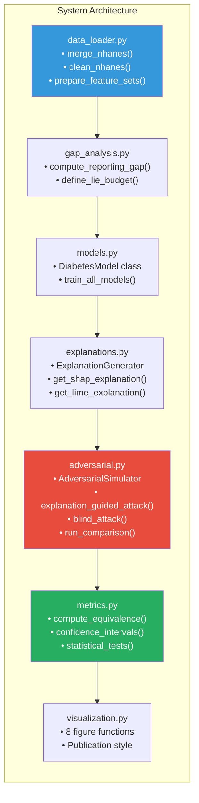

# 📕 Stage 10: Thesis & Final Project Report
## Period: 15 April – 31 May 2027 (6.5 weeks)

> **← Previous**: [Stage 9 — Research Paper](file:///c:/Users/ashua/OneDrive/ドキュメント/Desktop/BTP/roadmap/09_paper_writing.md)
> **← Back to** [Master Roadmap](file:///c:/Users/ashua/OneDrive/ドキュメント/Desktop/BTP/roadmap/00_master_roadmap.md)
> **→ Next Stage**: [Stage 11 — Viva](file:///c:/Users/ashua/OneDrive/ドキュメント/Desktop/BTP/roadmap/11_viva.md)

---

## 🎯 Objectives

1. Write the full B.Tech final year project thesis following DTU's format
2. Expand the research paper into a comprehensive thesis with additional chapters
3. Include all supporting material (code documentation, dataset details, supplementary results)
4. Format per DTU CSE department guidelines
5. Submit to the department before the deadline

---

## 📋 Prerequisites (from Stage 9)

- [x] Research paper draft complete (or submitted)
- [x] All results, figures, and tables finalized
- [x] References verified

---

## 📝 Thesis Chapter Structure

The thesis is a more detailed expansion of the research paper. It includes background theory, detailed methodology, and appendices that a conference paper cannot accommodate.

```mermaid
flowchart TD
    subgraph Thesis["📕 B.Tech Thesis Structure"]
        direction TB
        P["Preliminary Pages<br/>• Title Page<br/>• Certificate<br/>• Declaration<br/>• Acknowledgements<br/>• Abstract<br/>• Table of Contents<br/>• List of Figures/Tables"]
        C1["Chapter 1: Introduction<br/>(~8–10 pages)<br/>• Background & motivation<br/>• Problem statement<br/>• Objectives<br/>• Scope & limitations<br/>• Organization of thesis"]
        C2["Chapter 2: Literature Review<br/>(~10–15 pages)<br/>• XAI overview (SHAP, LIME)<br/>• Strategic classification<br/>• Adversarial robustness<br/>• Algorithmic recourse<br/>• Research gap"]
        C3["Chapter 3: Methodology<br/>(~12–15 pages)<br/>• Dataset description<br/>• Data preprocessing<br/>• Two-model design<br/>• Adversarial strategies<br/>• Metric definitions<br/>• Pre-registration"]
        C4["Chapter 4: Implementation<br/>(~8–10 pages)<br/>• System architecture<br/>• Technology stack<br/>• Code structure<br/>• Key algorithms<br/>• Reproducibility"]
        C5["Chapter 5: Results & Analysis<br/>(~12–15 pages)<br/>• Model performance<br/>• Reporting gap analysis<br/>• Main equivalence results<br/>• Statistical tests<br/>• Model A vs B comparison<br/>• SHAP vs LIME comparison"]
        C6["Chapter 6: Discussion<br/>(~5–8 pages)<br/>• Interpretation<br/>• Policy implications<br/>• Limitations<br/>• Comparison with prior work"]
        C7["Chapter 7: Conclusion<br/>& Future Work<br/>(~3–5 pages)<br/>• Summary of findings<br/>• Contributions<br/>• Future directions"]
        A["Appendices<br/>• Appendix A: NHANES column mapping<br/>• Appendix B: Full statistical tables<br/>• Appendix C: Additional figures<br/>• Appendix D: Code repository"]
        R["References<br/>(all cited works)"]
    end

    P --> C1 --> C2 --> C3 --> C4 --> C5 --> C6 --> C7 --> A --> R

    style C3 fill:#e67e22,color:#fff
    style C5 fill:#27ae60,color:#fff
    style C7 fill:#3498db,color:#fff
```

---

## ✏️ Writing Assignments

| Chapter | Primary Writer | Reviewer | Pages (approx.) | Deadline |
|---------|---------------|----------|-----------------|----------|
| Preliminary Pages | Ishan Singh | All | 5–7 | Week 1 |
| Ch 1: Introduction | Akash Singh | Aditya Jha | 8–10 | Week 2 |
| Ch 2: Literature Review | Akash Singh | Akshat Kumar | 10–15 | Week 2 |
| Ch 3: Methodology | Aditya Jha | Akash Singh | 12–15 | Week 3 |
| Ch 4: Implementation | Aditya Jha | Akshat Kumar | 8–10 | Week 3 |
| Ch 5: Results & Analysis | Akshat Kumar | Aditya Jha | 12–15 | Week 4 |
| Ch 6: Discussion | Akshat Kumar | Akash Singh | 5–8 | Week 4 |
| Ch 7: Conclusion | Akash Singh | All | 3–5 | Week 5 |
| Appendices | Ishan Singh | All | 10–15 | Week 5 |
| Full thesis review | All | Guide | — | Week 6 |

**Total estimated length: 75–105 pages**

---

## 📐 Thesis vs. Research Paper — What's Different

| Aspect | Research Paper (Stage 9) | Thesis (Stage 10) |
|--------|------------------------|-------------------|
| **Length** | 8–10 pages | 75–105 pages |
| **Background** | Brief (1 paragraph) | Full chapter with theory |
| **Literature** | 1.5 pages, key papers only | 10–15 pages, comprehensive |
| **Methodology** | Concise, assumes reader expertise | Step-by-step, accessible to undergrads |
| **Implementation** | Not included | Full chapter with architecture diagrams |
| **Results** | Key figures only | All figures + supplementary |
| **Appendices** | None (or supplementary) | Column mapping, full tables, code docs |

> [!TIP]
> **Reuse content from the research paper** — Chapters 1, 3, 5, and 7 of the thesis can draw heavily from the paper's Introduction, Methodology, Results, and Conclusion sections. Expand, don't rewrite.

---

## 📐 Thesis-Specific Content to Add

### Chapter 2 — Expanded Literature Review Topics

| Topic | Key Papers to Cover | Pages |
|-------|-------------------|-------|
| What is Explainable AI? | Molnar (2020), Doshi-Velez & Kim (2017) | 2–3 |
| LIME deep dive | Ribeiro et al. (2016) — algorithm, examples | 2–3 |
| SHAP deep dive | Lundberg & Lee (2017) — Shapley theory, TreeSHAP | 2–3 |
| Sanity checks for explanations | Adebayo et al. (2018) | 1–2 |
| Strategic classification | Hardt et al. (2016), Ghalme et al. (2021) | 2–3 |
| Algorithmic recourse | Ustun et al. (2019), König et al. (2023) | 1–2 |
| Privacy risks of explanations | Shokri et al. (2021), Milli et al. (2019) | 1–2 |

### Chapter 4 — Implementation Details to Document

---

## 📅 Writing Schedule

| Week | Focus | Milestone |
|------|-------|-----------|
| Week 1 (Apr 15–21) | Preliminary pages + Chapter 1 outline | Title page, abstract, ToC drafted |
| Week 2 (Apr 22–28) | Chapters 1 & 2 complete | Introduction + full literature review |
| Week 3 (Apr 29–May 5) | Chapters 3 & 4 complete | Methodology + implementation |
| Week 4 (May 6–12) | Chapters 5 & 6 complete | Results + discussion |
| Week 5 (May 13–19) | Chapter 7 + appendices | Conclusion + supplementary material |
| Week 5.5 (May 20–25) | Guide review | Miss. Anjali Bansal reviews full thesis |
| Week 6 (May 26–31) | Final revisions + **submit** | Thesis submitted to department |

---

## ✅ Completion Checklist

- [ ] DTU thesis LaTeX/Word template obtained
- [ ] All 7 chapters drafted
- [ ] All figures and tables from Stage 8 embedded
- [ ] Appendices complete (column mapping, full tables, code docs)
- [ ] Abstract written (≤ 300 words)
- [ ] Table of Contents auto-generated and correct
- [ ] List of Figures and List of Tables generated
- [ ] Page numbers, headers, footers formatted
- [ ] All references in consistent citation style
- [ ] Plagiarism check run (Turnitin or equivalent)
- [ ] Guide has reviewed and signed off
- [ ] PDF exported and submitted to department
- [ ] Printed copies prepared (if required)
