# 🎓 Stage 11: Viva Preparation & Final Submission
## Period: 22 May – 14 June 2027 (3.5 weeks)

> **← Previous**: [Stage 10 — Thesis](file:///c:/Users/ashua/OneDrive/ドキュメント/Desktop/BTP/roadmap/10_thesis.md)
> **← Back to** [Master Roadmap](file:///c:/Users/ashua/OneDrive/ドキュメント/Desktop/BTP/roadmap/00_master_roadmap.md)

---

## 🎯 Objectives

1. Prepare a compelling viva presentation (20–30 minutes)
2. Prepare a live demo of the experimental pipeline
3. Anticipate and prepare for examiner questions
4. Conduct rehearsal presentations
5. Make the final submission of all project materials

---

## 📋 Prerequisites (from Stage 10)

- [x] Thesis submitted and approved by guide
- [x] Research paper submitted (or in review)
- [x] All code, data, and results organized in the repository

---

## 🖥️ Presentation Structure

### Slide Deck Outline (25–30 slides)

```mermaid
flowchart TD
    subgraph Presentation["🎤 Viva Presentation Flow"]
        S1["Slides 1–2<br/>Title + Team<br/>(1 min)"]
        S2["Slides 3–5<br/>Problem & Motivation<br/>Why this matters<br/>(3 min)"]
        S3["Slides 6–8<br/>Literature & Gap<br/>What's missing in research<br/>(3 min)"]
        S4["Slides 9–14<br/>Methodology<br/>Two models, strategies,<br/>lie budget, metrics<br/>(6 min)"]
        S5["Slides 15–16<br/>Dataset & Setup<br/>NHANES, tools, pre-reg<br/>(2 min)"]
        S6["Slides 17–22<br/>Results<br/>Main findings, figures,<br/>statistical tests<br/>(6 min)"]
        S7["Slides 23–25<br/>Discussion<br/>Implications, limitations<br/>(3 min)"]
        S8["Slides 26–27<br/>Conclusion &<br/>Future Work<br/>(2 min)"]
        S9["Slides 28–30<br/>Demo + Q&A<br/>(5+ min)"]
    end

    S1 --> S2 --> S3 --> S4 --> S5 --> S6 --> S7 --> S8 --> S9

    style S4 fill:#e67e22,color:#fff
    style S6 fill:#27ae60,color:#fff
    style S9 fill:#e74c3c,color:#fff
```



---

## 🎤 Slide-by-Slide Guide

### Slides 1–2: Title & Team
- Project title (full)
- All team member names with photos (optional)
- Guide name
- Group ID: GP-109
- DTU + CSE department logo

### Slides 3–5: Problem & Motivation
- **Slide 3**: "Hospitals use ML to score health risk. Laws require explanations."
- **Slide 4**: "Worry: Explanations = instructions for gaming the model."
- **Slide 5**: "But can't you just try different inputs without any explanation? Nobody has tested this."
- **Key visual**: The comparison flowchart (explanation-guided vs. blind)

### Slides 6–8: Literature & Gap
- **Slide 6**: Timeline of key papers (LIME 2016, SHAP 2017, Milli 2019, etc.)
- **Slide 7**: What prior work studied vs. what we study
- **Slide 8**: **The gap** — "No study measures explanation advantage for self-score manipulation"

### Slides 9–14: Methodology (MOST IMPORTANT)
- **Slide 9**: NHANES dataset overview — what makes it unique (paired data)
- **Slide 10**: The two-model design (Model A measured, Model B reported)
- **Slide 11**: The "realistic lie budget" from reporting gaps
- **Slide 12**: Strategy 1 — Explanation-guided attack (with diagram)
- **Slide 13**: Strategy 2 — Blind trial-and-error (with diagram)
- **Slide 14**: The metric: "1 explanation ≈ X blind attempts"

### Slides 15–16: Setup & Pre-Registration
- **Slide 15**: Tech stack, datasets, compute requirements
- **Slide 16**: Pre-registration — why we did it, link to published plan

### Slides 17–22: Results (SECOND MOST IMPORTANT)
- **Slide 17**: Model performance table (all 4 models)
- **Slide 18**: Reporting gap distributions (height + weight)
- **Slide 19**: **Main result figure** — the equivalence curve
- **Slide 20**: Score reduction box plots
- **Slide 21**: Model A vs. Model B comparison
- **Slide 22**: Statistical significance summary

### Slides 23–25: Discussion
- **Slide 23**: What the main number means for policy
- **Slide 24**: Limitations and threats to validity
- **Slide 25**: Comparison with Milli et al. (2019) and Shokri et al. (2021)

### Slides 26–27: Conclusion & Future Work
- **Slide 26**: Three key takeaways (bullet points)
- **Slide 27**: Future work — other domains, other explanation methods, real user study

### Slides 28–30: Demo & Q&A
- **Slide 28**: Live demo introduction
- **Slide 29**: Run the pipeline on a single patient (show explanation → attack → score change)
- **Slide 30**: "Thank you" + Q&A

---

## 🔮 Anticipated Examiner Questions & Prepared Answers

| # | Expected Question | Key Points for Answer |
|---|-------------------|----------------------|
| 1 | "Why NHANES specifically?" | Only public dataset with BOTH self-reported and measured height/weight for the SAME people, plus objective diabetes outcome from blood test |
| 2 | "Why not a real user study?" | Scope limitation; simulation provides a controlled upper bound; real user study is future work |
| 3 | "How do you know the lie budget is realistic?" | It's derived from actual human misreporting patterns in 10,000+ NHANES respondents |
| 4 | "What if someone lies about more than height/weight?" | Our study focuses on the features with paired data; the methodology generalizes |
| 5 | "Why pre-register?" | Prevents p-hacking and HARKing; standard in medicine, rare in ML — shows rigor |
| 6 | "What if SHAP and LIME disagree?" | We report both; disagreement itself is an interesting finding about explanation reliability |
| 7 | "Why logistic regression AND random forest?" | Tests whether the result depends on model complexity; LR is interpretable baseline, RF is realistic |
| 8 | "How does this differ from Milli et al.?" | Milli studied model-stealing; we study a patient manipulating their OWN score with realistic constraints |
| 9 | "What's the practical recommendation?" | If explanations add little: show them openly, invest in input verification instead |
| 10 | "Can this be used for insurance fraud?" | We study the risk TO MEASURE IT, not to enable it; knowing the threat is the first step to defense |
| 11 | "Why 95th percentile for lie budget?" | Standard in statistics for "extreme but plausible"; sensitivity analysis can test 90th and 99th |
| 12 | "Is this generalizable beyond diabetes?" | Methodology generalizes; specific numbers are domain-specific. Future work on other models |

---

## 🖥️ Live Demo Script

```python
"""
scripts/demo.py
Interactive demo for viva presentation.
Shows the full pipeline on a single patient.
"""
import sys
sys.path.append('..')
from src.config import set_all_seeds
set_all_seeds()

# ... (load model and data)

def demo_single_patient(patient_idx=42):
    """
    Walk through the experiment for one patient.
    Designed to be run interactively during viva.
    """
    print("="*60)
    print(f"DEMO: Patient #{patient_idx}")
    print("="*60)
    
    x = X_test[patient_idx]
    original_score = model.predict_proba(x.reshape(1, -1))[0]
    print(f"\n1. Original diabetes risk score: {original_score:.4f}")
    print(f"   Features: {dict(zip(feature_names, x))}")
    
    # Show explanation
    print(f"\n2. SHAP Explanation:")
    attributions = explainer.get_shap_explanation(x)
    for feat, val in list(attributions.items())[:5]:
        direction = "↑ risk" if val > 0 else "↓ risk"
        print(f"   {feat:25s}: {val:+.4f} ({direction})")
    
    # Explanation-guided attack
    print(f"\n3. Explanation-guided attack:")
    result = simulator.explanation_guided_attack(x, method='shap')
    print(f"   Changed: {result['changed_feature']}")
    print(f"   New score: {result['new_score']:.4f}")
    print(f"   Reduction: {result['score_reduction']:.4f}")
    
    # Blind attempts comparison
    print(f"\n4. Blind trial-and-error comparison:")
    for n in [1, 5, 10, 20, 50]:
        blind = simulator.blind_attack(x, n_attempts=n)
        print(f"   N={n:3d} attempts → best score: {blind['best_score']:.4f} "
              f"(reduction: {blind['score_reduction']:.4f})")
    
    print(f"\n5. CONCLUSION for this patient:")
    print(f"   The explanation achieved the same as ~{equiv:.0f} blind attempts")

demo_single_patient()
```

---

## 📅 Preparation Schedule

| Week | Activity |
|------|----------|
| Week 1 (May 22–28) | Create slide deck, assign slides, prepare demo script |
| Week 2 (May 29–Jun 4) | Slides complete, first rehearsal within team |
| Week 3 (Jun 5–11) | Rehearsal with guide, incorporate feedback, practice Q&A |
| Final days (Jun 12–14) | Final rehearsal, backup slides printed, **viva day** |

---

## 📦 Final Submission Package

| Item | Format | Status |
|------|--------|--------|
| Thesis PDF | PDF (DTU format) | ☐ |
| Presentation slides | PPTX / PDF | ☐ |
| Source code | GitHub repository (public) | ☐ |
| Processed datasets | `data/processed/*.pkl` | ☐ |
| All result figures | `results/figures/*.png` (300 DPI) | ☐ |
| All result tables | `results/tables/*.csv` + LaTeX | ☐ |
| Pre-registration DOI | URL/DOI link | ☐ |
| Research paper | PDF (submitted / in review) | ☐ |
| Demo script | `scripts/demo.py` | ☐ |
| Video recording of demo | MP4 (backup if live demo fails) | ☐ |

---

## ✅ Final Completion Checklist

- [ ] Slide deck prepared (25–30 slides)
- [ ] Live demo tested and working
- [ ] Backup demo video recorded (in case of technical issues)
- [ ] All 12 anticipated questions rehearsed
- [ ] At least 2 full rehearsals completed
- [ ] Guide has reviewed and approved the presentation
- [ ] All submission materials assembled
- [ ] Printed copies of thesis prepared (if required by DTU)
- [ ] USB backup of all materials
- [ ] Formal attire prepared for viva day
- [ ] 🎓 **VIVA COMPLETE!**

---

> [!NOTE]
> **After the viva**: Consider making the GitHub repository public with a clear README, the pre-registration link, and a link to the thesis. This makes the work citable and reproducible — valuable for graduate school applications or industry portfolios.
